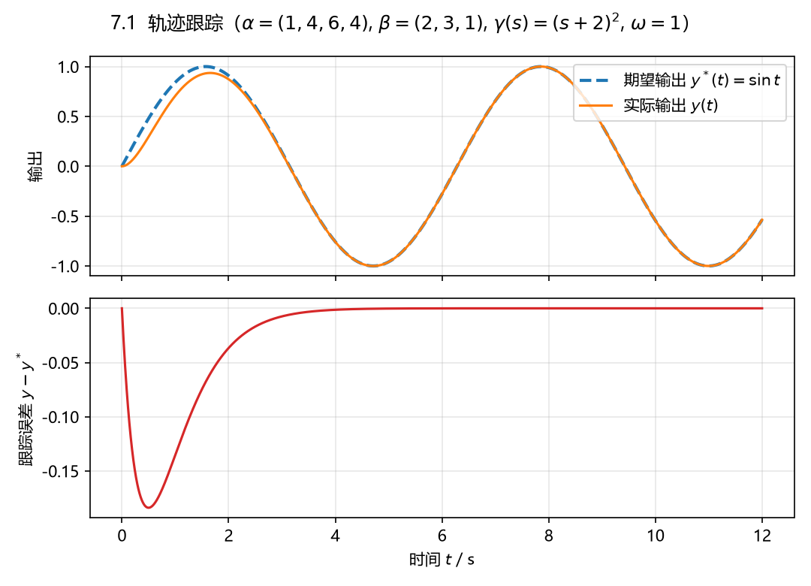

# 7.1 SISO 系统对 $y^*=\sin\omega t$ 的跟踪

## 题目

考虑 SISO 线性系统

$$
\dot x=\begin{bmatrix}
0&1&0&0\\
0&0&1&0\\
0&0&0&1\\
-\alpha_0&-\alpha_1&-\alpha_2&-\alpha_3
\end{bmatrix}x+\begin{bmatrix}0\\0\\0\\1\end{bmatrix}u,\qquad
y=\begin{bmatrix}\beta_0&\beta_1&\beta_2&0\end{bmatrix}x,
$$

$\beta_i\,(i=0,1,2)$、$\alpha_i\,(i=0,1,2,3)$ 为常数，$\beta_2s^2+\beta_1s+\beta_0$ 是 Hurwitz 多项式；
期望输出 $y^*=\sin\omega t$（$\omega>0$），设计 $u$ 使 $y$ 跟踪 $y^*$。

## 答案

**1）传函、相对阶、耦合矩阵**

$$
G(s)=C(sI-A)^{-1}B=\frac{\beta_2s^2+\beta_1s+\beta_0}{s^4+\alpha_3s^3+\alpha_2s^2+\alpha_1s+\alpha_0}.
$$

分子 Hurwitz（题设）$\Rightarrow$ 最小相位；分子 2 次、分母 4 次。又

$$
cB=\begin{bmatrix}\beta_0&\beta_1&\beta_2&0\end{bmatrix}\begin{bmatrix}0\\0\\0\\1\end{bmatrix}=0,\qquad
cAB=\beta_2\neq0,
$$

故

$$
\boxed{\,r=2,\qquad \Gamma(A,B,C)=cAB=\beta_2\neq0\,}
$$

**2）控制律（定理 7.1.1，(7.10)）**

任取二次首一 Hurwitz 多项式 $\gamma(s)=s^2+\gamma_1s+\gamma_0$，则

$$
u=\Gamma^{-1}\big[-c\gamma(A)x+v^*\big]
 =\frac{1}{\beta_2}\Big[-c\big(A^2+\gamma_1A+\gamma_0I\big)x+v^*\Big],
$$

$$
v^*=\ddot y^*+\gamma_1\dot y^*+\gamma_0y^* .
$$

代入 $y^*=\sin\omega t$（$\dot y^*=\omega\cos\omega t$，$\ddot y^*=-\omega^2\sin\omega t$）：

$$
\boxed{\,v^*=(\gamma_0-\omega^2)\sin\omega t+\gamma_1\omega\cos\omega t\,}
$$

**3）状态反馈 + 前馈的形式**

$$
u=Kx+\frac{1}{\beta_2}v^*,\qquad K=-\frac{1}{\beta_2}c\big(A^2+\gamma_1A+\gamma_0I\big),
$$

$$
K=\Big[\;
\alpha_0-\frac{\beta_0\gamma_0}{\beta_2},\quad
\alpha_1-\frac{\beta_0\gamma_1+\beta_1\gamma_0}{\beta_2},\quad
\alpha_2-\gamma_0-\frac{\beta_0+\beta_1\gamma_1}{\beta_2},\quad
\alpha_3-\gamma_1-\frac{\beta_1}{\beta_2}\;\Big].
$$

**4）为什么能跟踪**

取 $e_1=y-y^*$、$e_2=\dot y-\dot y^*$，由 (7.4)-(7.6) 得

$$
\begin{bmatrix}\dot e_1\\ \dot e_2\end{bmatrix}
=\begin{bmatrix}0&1\\-\gamma_0&-\gamma_1\end{bmatrix}
\begin{bmatrix}e_1\\ e_2\end{bmatrix},
\qquad \lambda(A_e)=\{\gamma(s)\text{ 的根}\},
$$

$\gamma$ Hurwitz $\Rightarrow e\to0$，即 $y\to y^*$、$\dot y\to\dot y^*$。（$y^*$ 至少 2 次可微、系统最小相位，
定理 7.1.1 的条件都满足；最小相位这一条正是用来保证 $\alpha_i$ 随便取时闭环状态仍有界的。）

## 数值验证

取 $\alpha=(1,4,6,4)$（$s^4+4s^3+6s^2+4s+1=(s+1)^4$，即 $A$ 的极点全是 $-1$）、
$\beta=(2,3,1)$（分子 $(s+1)(s+2)$）、$\gamma(s)=(s+2)^2$、$\omega=1$、$x(0)=0$，仿真 $t\in[0,12]$ s：

- $K=\begin{bmatrix}-7&-16&-12&-3\end{bmatrix}$，$\Gamma=\beta_2=1$；
- 误差系统极点 $\{-2,-2\}$；
- 稳态（最后 2 s）$\max|y-y^*|=2.0\times10^{-8}$。



## 复算

```powershell
$py = 'D:\data\local\software\programming\Python\projects\.venv\Scripts\python.exe'
& $py 'D:\data\local\study\postgraduate\linear_system\projects\exercises\exports\ls_07\ex_1.py'
```

依赖：`linear_system_utils.cal_matrix_operation.cal_tracking_control`
（`cal_coupling_matrix`、`cal_tracking_control`、`cal_reference_vector`、`cal_error_dynamics`）。
