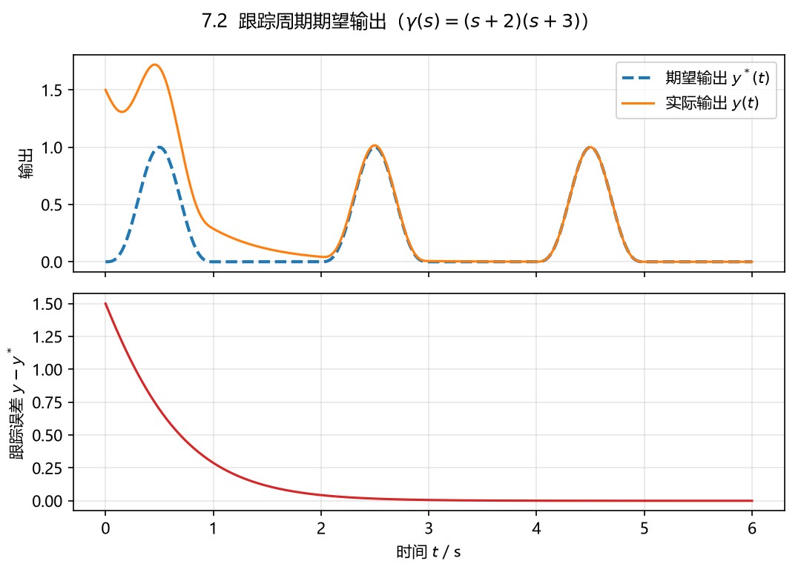

# 7.2 最小相位 SISO 系统跟踪周期期望输出

## 题目

$$
\dot x=\begin{bmatrix}
-1&1&2&-1\\
0&-2&1&-1\\
-1&0&-2&1\\
1&0&1&0
\end{bmatrix}x+\begin{bmatrix}0\\1\\0\\1\end{bmatrix}u,\qquad
y=\begin{bmatrix}1&0&1&0\end{bmatrix}x ,
$$

期望输出 $y^*$ 是周期为 2 的周期信号：

$$
y^*(t)=\begin{cases}\sin^3(\pi t),& t\in[0,1],\\ 0,& t\in[1,2].\end{cases}
$$

设计 $u$ 使输出跟踪 $y^*$，并画跟踪曲线。

## 答案

**1）传函、零点、相对阶**

$$
G(s)=\frac{s^2+2s+4}{s^4+5s^3+10s^2+8s-4},
\qquad \text{零点}=-1\pm\mathrm{j}\sqrt3\ (\text{左半平面，最小相位}),
$$

极点 $\approx\{-2.550,\ 0.3348,\ -1.392\pm1.657\mathrm{j}\}$（$A$ 本身不稳定，但传函零点稳定，属最小相位系统）。

$cB=0$，$cAB=1\neq0$，故

$$
\boxed{r=2,\qquad \Gamma=cAB=1}
$$

**2）控制律**

取 $\gamma(s)=(s+2)(s+3)=s^2+5s+6$，则 $u=\Gamma^{-1}[-c\gamma(A)x+v^*]=Kx+v^*$，

$$
\boxed{K=-\big[cA^2+5cA+6c\big]=\begin{bmatrix}2&-1&-3&-1\end{bmatrix}},
\qquad
v^*=\ddot y^*+5\dot y^*+6y^* .
$$

即

$$
u=2x_1-x_2-3x_3-x_4+v^* .
$$

**3）参考前馈 $v^*$**

在 $t\in[0,1]$ 上 $y^*=\sin^3(\pi t)=\tfrac14\big(3\sin\pi t-\sin3\pi t\big)$，

$$
\dot y^*=\tfrac{3\pi}{4}\big(\cos\pi t-\cos3\pi t\big),\qquad
\ddot y^*=\tfrac{3\pi^2}{4}\big(3\sin3\pi t-\sin\pi t\big),
$$

$$
\boxed{v^*=\tfrac14\Big[(9\pi^2-6)\sin3\pi t+(18-3\pi^2)\sin\pi t+15\pi\cos\pi t-15\pi\cos3\pi t\Big]}
$$

而在 $t\in[1,2]$ 上 $y^*\equiv0\Rightarrow v^*=0$；按周期性，把 $t$ 换成 $t\bmod 2$ 即可。

两个拼接点 $t=1,2$ 处 $y^*$ 及其一、二阶导数都为 0，所以 $y^*\in C^2$，定理 7.1.1 的条件满足。

**4）跟踪误差**

$e_1=y-y^*$、$e_2=\dot y-\dot y^*$ 满足

$$
\begin{bmatrix}\dot e_1\\ \dot e_2\end{bmatrix}
=\begin{bmatrix}0&1\\-6&-5\end{bmatrix}
\begin{bmatrix}e_1\\ e_2\end{bmatrix},
\qquad \lambda=\{-2,-3\}\ \Rightarrow\ e\to0 .
$$

## 数值验证

$x(0)=\begin{bmatrix}0.5&-1&1&0\end{bmatrix}^{\mathsf T}$，仿真 $t\in[0,6]$ s（3 个周期）：

- $y(0)=x_1(0)+x_3(0)=1.5$，起动段误差最大 1.5，之后按 $e^{-2t}$ 衰减；
- 最后 2 s 内 $\max|y-y^*|=8.3\times10^{-4}$（仍在衰减），约 $t=2$ 以后肉眼已重合；
- 闭环状态有界，$\max_t\|x(t)\|=6.62$（零动态极点是传函零点 $-1\pm\mathrm{j}\sqrt3$，稳定）。



## 复算

```powershell
$py = 'D:\data\local\software\programming\Python\projects\.venv\Scripts\python.exe'
& $py 'D:\data\local\study\postgraduate\linear_system\projects\exercises\exports\ls_07\ex_2.py'
```

脚本里用 `cal_reference_vector` 逐阶求导，并核对了它与上面化简式的一致性。
