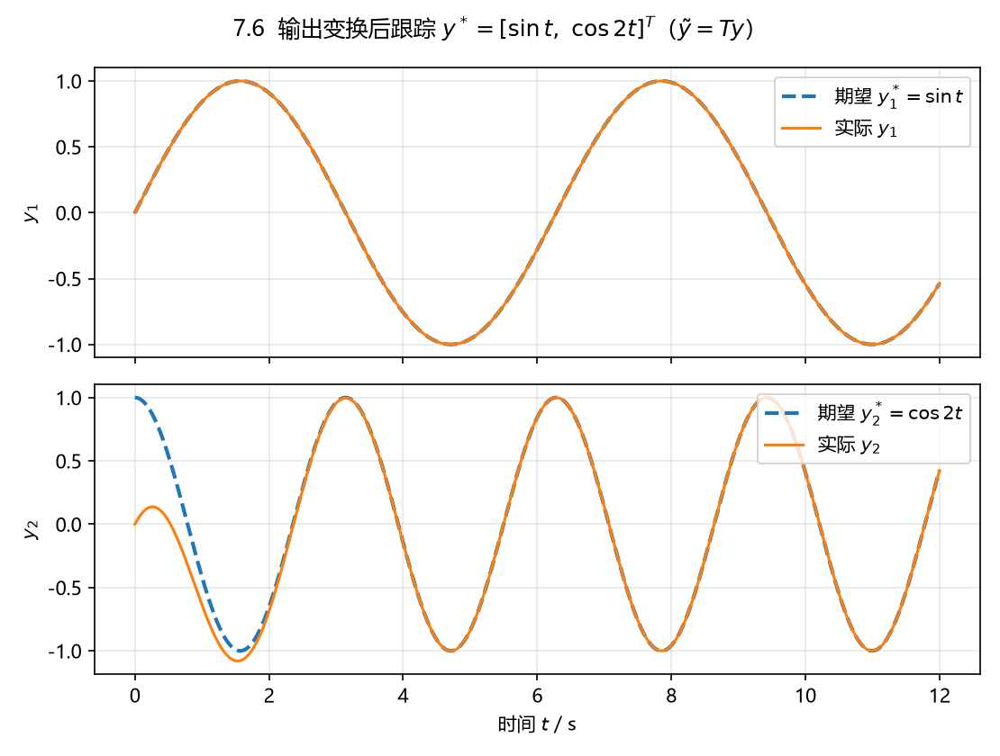

# 7.6 耦合矩阵奇异 → 输出变换 → 跟踪

## 题目

$$
\dot x=\begin{bmatrix}0&1&0\\-1&0&1\\1&-2&0\end{bmatrix}x
+\begin{bmatrix}1&0\\0&0\\0&1\end{bmatrix}u,\qquad
y=\begin{bmatrix}1&-1&1\\1&1&1\end{bmatrix}x .
$$

(1) 判断该系统的耦合矩阵是否奇异；(2) 若是，做输出变换

$$
\tilde y=\begin{bmatrix}1&0\\-1&1\end{bmatrix}y=\begin{bmatrix}1&-1&1\\0&2&0\end{bmatrix}x,
$$

判断以 $\tilde y$ 为新输出的系统耦合矩阵是否非奇异；(3) 若是，设计 $u$ 使原系统输出
$y$ 跟踪 $y^*=\begin{bmatrix}\sin t&\cos2t\end{bmatrix}^{\mathsf T}$。

## 答案

**1）原耦合矩阵奇异**

$c_1B=\begin{bmatrix}1&1\end{bmatrix}$、$c_2B=\begin{bmatrix}1&1\end{bmatrix}$，两行相同：

$$
\boxed{\Gamma(A,B,C)=CB=\begin{bmatrix}1&1\\1&1\end{bmatrix},\quad \det=0,\ \operatorname{rank}=1\ \Rightarrow\ \text{奇异}}
$$

两个输出的相对阶都是 $r_1=r_2=1$，但 $c_1B=c_2B$，两路输出不独立，静态状态反馈不能分别跟踪。
（另外 $\det G(s)=4/(s^3+3s-1)$ 无有限零点，系统本身是最小相位的。）

**2）输出变换后的耦合矩阵非奇异**

$$
\tilde C=TC=\begin{bmatrix}1&-1&1\\0&2&0\end{bmatrix},\qquad
\tilde c_1B=\begin{bmatrix}1&1\end{bmatrix}\neq0,\quad
\tilde c_2B=\begin{bmatrix}0&0\end{bmatrix},\quad
\tilde c_2AB=\begin{bmatrix}-2&2\end{bmatrix}\neq0,
$$

所以 $\tilde r_1=1,\ \tilde r_2=2$，

$$
\boxed{\tilde\Gamma(A,B,\tilde C)=\begin{bmatrix}1&1\\-2&2\end{bmatrix},\quad \det=4\neq0\ \Rightarrow\ \text{非奇异}}
$$

**3）对 $\tilde y$ 设计跟踪律**

取 $\gamma_1(s)=s+2$、$\gamma_2(s)=(s+2)(s+3)=s^2+5s+6$，按 (7.10)

$$
u=\tilde\Gamma^{-1}\Big[-\tilde c_1\gamma_1(A)x+v_1^*;\ -\tilde c_2\gamma_2(A)x+v_2^*\Big]
=Kx+\tilde\Gamma^{-1}\tilde v^*,
$$

$$
\boxed{K=\begin{bmatrix}-4&3&2\\0&0&-3\end{bmatrix}},
\qquad
\boxed{\tilde\Gamma^{-1}=\frac14\begin{bmatrix}2&-1\\2&1\end{bmatrix}},
$$

$\tilde v^*=\big[\dot{\tilde y}_1^*+\gamma_{10}\tilde y_1^*;\ \ddot{\tilde y}_2^*+\gamma_{21}\dot{\tilde y}_2^*+\gamma_{20}\tilde y_2^*\big]^{\mathsf T}$，其中
$\tilde y^*=Ty^*=\begin{bmatrix}\sin t&\cos2t-\sin t\end{bmatrix}^{\mathsf T}$：

$$
\boxed{\tilde v^*=\begin{bmatrix}2\sin t+\cos t\\[2pt] 2\cos2t-10\sin2t-5\sin t-5\cos t\end{bmatrix}}
$$

（第一行 $=\dot y_1^*+2y_1^*$；第二行 $=\ddot{\tilde y}_2^*+5\dot{\tilde y}_2^*+6\tilde y_2^*$。）

**4）为什么 $y$ 也跟着 $y^*$**

$y=T^{-1}\tilde y$，$T^{-1}=\begin{bmatrix}1&0\\1&1\end{bmatrix}$。$\tilde y\to\tilde y^*=Ty^*$ 故 $y\to y^*$。误差
$\tilde e=\big[\tilde y_1-\tilde y_1^*,\ \tilde y_2-\tilde y_2^*,\ \dot{\tilde y}_2-\dot{\tilde y}_2^*\big]^{\mathsf T}$ 满足

$$
A_e=\begin{bmatrix}-2&0&0\\0&0&1\\0&-6&-5\end{bmatrix},
\qquad \lambda(A_e)=\{-2,-2,-3\}\ \Rightarrow\ \tilde e\to0 .
$$

## 数值验证

$x(0)=0$，仿真 $t\in[0,12]$ s：最后 2 s 内 $\max|y_1-y_1^*|=1.0\times10^{-11}$、
$\max|y_2-y_2^*|=4.1\times10^{-9}$；$y_2$ 初值有 1 的偏差，约 $t=2$ s 后完全跟上。



## 复算

```powershell
$py = 'D:\data\local\software\programming\Python\projects\.venv\Scripts\python.exe'
& $py 'D:\data\local\study\postgraduate\linear_system\projects\exercises\exports\ls_07\ex_6.py'
```
