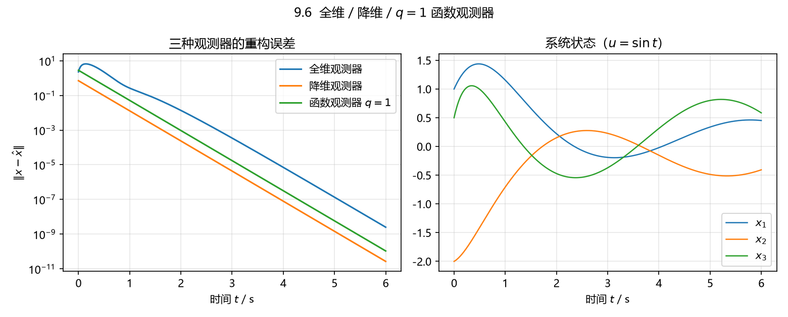

# 9.6 全维、降维与 $q=1$ 函数观测器

## 题目

$$
\dot x=\begin{bmatrix}-2&-2&0\\0&0&1\\0&-3&-4\end{bmatrix}x+\begin{bmatrix}0\\1\\-2\end{bmatrix}u,
\qquad
y=\begin{bmatrix}1&0&1\\0&1&0\end{bmatrix}x .
$$

试分别设计该系统的全维状态观测器、降维状态观测器和 $q=1$ 的函数观测器，其中 $R=I_3$。

## 答案

### 0）准备：能观性、极点、设计取值

$$
O=\begin{bmatrix}C\\CA\\CA^2\end{bmatrix}
=\begin{bmatrix}1&0&1\\0&1&0\\-2&-5&-4\\0&0&1\\4&16&11\\0&-3&-4\end{bmatrix},
\qquad \operatorname{rank}O=3=n\ \Rightarrow\ (A,C)\ \text{能观},
$$

$$
\lambda(A)=\{-1,-2,-3\}.
$$

题目没给观测器极点，这里取

| 观测器 | 阶数 | 误差极点 |
|---|---|---|
| 全维 | $n=3$ | $-4,-5,-6$ |
| 降维 | $n-p=1$ | $-4$ |
| 函数观测器 $R=I_3$ | $q=1$ | $-4$（$F=[-4]$） |

取 $-4$ 而不是 $-1/-2/-3$ 的原因：函数观测器要解 Sylvester 方程 $TA-FT=GC$，要求
$\lambda(F)\cap\lambda(A)=\varnothing$，否则 $T$ 不唯一或不存在。

### 1）全维状态观测器

$$
\boxed{L=\frac14\begin{bmatrix}-35&-66\\45&98\\-99&-230\end{bmatrix}},\qquad
\hat x'=A\hat x+Bu-L\,(y-C\hat x),
$$

等价地写成课件 (9.31) 的统一形式 $\hat x'=F\hat x+Gy+Hu$：

$$
\boxed{F=A+LC=\frac14\begin{bmatrix}-43&-74&-35\\45&98&49\\-99&-242&-115\end{bmatrix},\quad
G=-L=\frac14\begin{bmatrix}35&66\\-45&-98\\99&230\end{bmatrix},\quad H=B=\begin{bmatrix}0\\1\\-2\end{bmatrix}}
$$

$\lambda(F)=\{-4,-5,-6\}$，误差 $e=x-\hat x$ 满足 $e'=Fe\to0$。

### 2）降维状态观测器（$n-p=1$ 阶）

取 $C_0$ 使 $CC_0=0$：$C_0=\begin{bmatrix}1&0&-1\end{bmatrix}^{\mathsf T}$，于是

$$
T_0^{-1}=\begin{bmatrix}C^{\mathsf T}(CC^{\mathsf T})^{-1} & C_0(C_0^{\mathsf T}C_0)^{-1}\end{bmatrix}
=\frac12\begin{bmatrix}1&0&1\\0&2&0\\1&0&-1\end{bmatrix},\qquad
T_0=\begin{bmatrix}1&0&1\\0&1&0\\1&0&-1\end{bmatrix},
$$

$$
\begin{bmatrix}A_{11}&A_{12}\\A_{21}&A_{22}\end{bmatrix}=T_0AT_0^{-1}
=\left[\begin{array}{cc|c}-3&-5&1\\ \tfrac12&0&-\tfrac12\\ \hline 1&1&-3\end{array}\right],
\qquad
\begin{bmatrix}B_1\\B_2\end{bmatrix}=T_0B=\left[\begin{array}{c}-2\\1\\ \hline 2\end{array}\right].
$$

$F=A_{22}+L_{21}A_{12}$ 取单极点 $-4$：由 $-3+L_{21}\begin{bmatrix}1&-\tfrac12\end{bmatrix}^{\mathsf T}=-4$ 取

$$
L_{21}=\begin{bmatrix}-1&0\end{bmatrix},
$$

按 (9.22)：

$$
\boxed{F=-4,\quad G=\begin{bmatrix}0&6\end{bmatrix},\quad H=4,\quad
M=\begin{bmatrix}\tfrac12\\0\\-\tfrac12\end{bmatrix},\quad N=\begin{bmatrix}1&0\\0&1\\0&0\end{bmatrix}}
$$

即观测器（$z$ 一维）

$$
\dot z=-4z+\begin{bmatrix}0&6\end{bmatrix}y+4u,
\qquad
\hat x=Mz+Ny=\begin{bmatrix}\tfrac12 z+y_1\\ y_2\\ -\tfrac12 z\end{bmatrix}.
$$

（$z$ 收敛到 $\bar x_2+L_{21}y=(x_1-x_3)-y_1=-2x_3$，即"没被直接测到的那个方向"与 $y_1$ 的
一个组合；稳态无差由 $ML_{21}+N=C^{\mathsf T}(CC^{\mathsf T})^{-1}$ 保证，已核对。）

### 3）$q=1$ 的函数观测器（$R=I_3$，重构整个状态）

函数观测器 $z'=Fz+Gy+Hu$、$\hat f=Mz+Ny$ 的条件是（9.32)-(9.34）

$$
H=TB,\qquad TA-FT=GC,\qquad MT+NC=R .
$$

取 $F=\begin{bmatrix}-4\end{bmatrix}$、$G=\begin{bmatrix}2&0\end{bmatrix}$（$F$ Hurwitz、单输入必能控、
$\lambda(F)\cap\lambda(A)=\varnothing$），解 Sylvester 方程得

$$
\boxed{T=\begin{bmatrix}1&2&2\end{bmatrix},\quad H=TB=-2,\quad
\Phi=\begin{bmatrix}T\\C\end{bmatrix}=\begin{bmatrix}1&2&2\\1&0&1\\0&1&0\end{bmatrix},\ \det\Phi=1},
$$

$$
\boxed{M=R\,\Phi^{-1}\text{ 的前 1 列}=\begin{bmatrix}-1\\0\\1\end{bmatrix},\qquad
N=R\,\Phi^{-1}\text{ 的后 2 列}=\begin{bmatrix}2&2\\0&1\\-1&-2\end{bmatrix}}
$$

即

$$
\dot z=-4z+\begin{bmatrix}2&0\end{bmatrix}y-2u,
\qquad
\hat x=Mz+Ny=\begin{bmatrix}-z+2y_1+2y_2\\ y_2\\ z-y_1-2y_2\end{bmatrix}.
$$

校验：$MT+NC=I_3$（$\|MT+NC-I_3\|=1.3\times10^{-15}$），$TA-FT-GC=0$。

> **备注（和降维观测器的关系）**：$q=n-p=1$ 的函数观测器与降维观测器同阶。若改取
> $G=\begin{bmatrix}0&6\end{bmatrix}$，则 $T=\begin{bmatrix}0&0&-2\end{bmatrix}$、$H=4$、
> $M=\begin{bmatrix}\tfrac12&0&-\tfrac12\end{bmatrix}^{\mathsf T}$、$N=\begin{bmatrix}1&0\\0&1\\0&0\end{bmatrix}$，
> 与上面第 2）问的降维观测器**完全相同**——这正是定理 9.3.2 说的"降维观测器是 $R=I_n$、
> $q=n-p$ 的函数观测器"。

## 数值验证

$x(0)=\begin{bmatrix}1&-2&0.5\end{bmatrix}^{\mathsf T}$，三个观测器初值都取 0，$u=\sin t$，仿真 6 s：

| 观测器 | 末端 $\|x-\hat x\|$ |
|---|---|
| 全维（极点 $-4,-5,-6$） | $2.5\times10^{-9}$ |
| 降维（极点 $-4$） | $2.7\times10^{-11}$ |
| 函数观测器（$q=1$，$F=-4$） | $1.1\times10^{-10}$ |



## 复算

```powershell
$py = 'D:\data\local\software\programming\Python\projects\.venv\Scripts\python.exe'
& $py 'D:\data\local\study\postgraduate\linear_system\projects\exercises\exports\ls_09\ex_6.py'
```

用到 `cal_full_order_observer`、`cal_reduced_order_observer`、`cal_function_observer`
（降维那一步为此补了 $q=1$、$p>q$ 时的对偶极点配置退路，见 `cal_observer._dual_state_gain`）。
