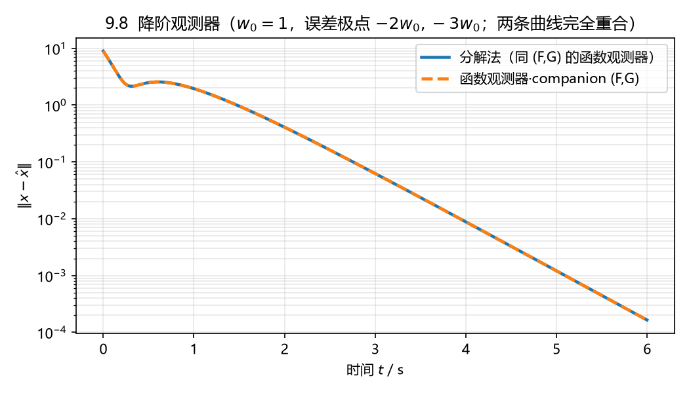

# 9.8 吊车系统的降阶观测器：系统分解 vs 函数观测器

## 题目

吊车系统的状态空间模型

$$
\dot x=\begin{bmatrix}0&1&0\\-\omega_0^2&0&\omega_0^2\\0&0&0\end{bmatrix}x+\begin{bmatrix}0\\0\\1\end{bmatrix}u,
\qquad
y=\begin{bmatrix}1&0&0\end{bmatrix}x,
$$

$\omega_0$ 是正常数。分别用**基于系统分解**和**基于函数观测器**的方法设计降阶状态观测器，
观测器误差系统极点为 $\{-2\omega_0,-3\omega_0\}$。

## 答案

$n=3,\ p=1\Rightarrow q=n-p=2$ 阶。$\lambda(A)=\{0,\pm\mathrm{j}\omega_0\}$，与 $\{-2\omega_0,-3\omega_0\}$
不相交，函数观测器的 Sylvester 方程有唯一解。

### 方法一：基于系统分解（(9.16)-(9.23)）

$C=\begin{bmatrix}1&0&0\end{bmatrix}$，取 $C_0=\begin{bmatrix}0&0\\1&0\\0&1\end{bmatrix}$（$CC_0=0$），

$$
T_0^{-1}=\begin{bmatrix}C^{\mathsf T}(CC^{\mathsf T})^{-1} & C_0(C_0^{\mathsf T}C_0)^{-1}\end{bmatrix}=I_3,
\qquad T_0=I_3,
$$

所以 $A$、$B$ 已经是分块好的：

$$
\begin{bmatrix}A_{11}&A_{12}\\A_{21}&A_{22}\end{bmatrix}
=\left[\begin{array}{c|cc}0&1&0\\ \hline -\omega_0^2&0&\omega_0^2\\ 0&0&0\end{array}\right],
\qquad
\begin{bmatrix}B_1\\B_2\end{bmatrix}=\left[\begin{array}{c}0\\ \hline 0\\1\end{array}\right].
$$

$F=A_{22}+L_{21}A_{12}$，$L_{21}\in\mathbb R^{2\times1}$：

$$
F=\begin{bmatrix}l_1&\omega_0^2\\ l_2&0\end{bmatrix},\qquad
\det(sI-F)=s^2-l_1s-l_2\omega_0^2\overset{!}{=}(s+2\omega_0)(s+3\omega_0)=s^2+5\omega_0s+6\omega_0^2,
$$

$$
\boxed{L_{21}=\begin{bmatrix}-5\omega_0\\-6\end{bmatrix}}
$$

按 (9.22) 算其余四个矩阵：

$$
\boxed{
F=\begin{bmatrix}-5\omega_0&\omega_0^2\\-6&0\end{bmatrix},\quad
G=\begin{bmatrix}-20\omega_0^2\\-30\omega_0\end{bmatrix},\quad
H=\begin{bmatrix}0\\1\end{bmatrix},\quad
M=\begin{bmatrix}0&0\\1&0\\0&1\end{bmatrix},\quad
N=\begin{bmatrix}1\\5\omega_0\\6\end{bmatrix}}
$$

观测器

$$
\dot z=\begin{bmatrix}-5\omega_0&\omega_0^2\\-6&0\end{bmatrix}z
+\begin{bmatrix}-20\omega_0^2\\-30\omega_0\end{bmatrix}y+\begin{bmatrix}0\\1\end{bmatrix}u,
\qquad
\hat x=Mz+Ny=\begin{bmatrix}y\\ z_1+5\omega_0y\\ z_2+6y\end{bmatrix}.
$$

$\lambda(F)=\{-2\omega_0,-3\omega_0\}$ ✔；$M L_{21}+N=C^{\mathsf T}(CC^{\mathsf T})^{-1}$ ✔（重构无差）。

### 方法二：基于函数观测器（(9.31)-(9.34)）

$R=I_3$、$q=n-p=2$，取与法一相同的 $(F,G)$（可控、Hurwitz、$\lambda(F)\cap\lambda(A)=\varnothing$），
解 Sylvester 方程 $TA-FT=GC$：

$$
\boxed{T=\begin{bmatrix}-5\omega_0&1&0\\-6&0&1\end{bmatrix}},\qquad
H=TB=\begin{bmatrix}0\\1\end{bmatrix},
$$

$$
\Phi=\begin{bmatrix}T\\C\end{bmatrix}=\begin{bmatrix}-5\omega_0&1&0\\-6&0&1\\1&0&0\end{bmatrix},\qquad
\det\Phi=1,
$$

$$
\boxed{
M=R\Phi^{-1}\text{ 的前 2 列}=\begin{bmatrix}0&0\\1&0\\0&1\end{bmatrix},\qquad
N=R\Phi^{-1}\text{ 的后 1 列}=\begin{bmatrix}1\\5\omega_0\\6\end{bmatrix}}
$$

于是 $z=\begin{bmatrix}-5\omega_0x_1+x_2\\-6x_1+x_3\end{bmatrix}$，
$\hat x=Mz+Ny$ 与法一**完全相同**：两种方法给出的是同一个降阶观测器（定理 9.3.2：
降维观测器就是 $R=I_n$、$q=n-p$ 的函数观测器）。

> **$(F,G)$ 的取法不唯一**。例如改取 $F=\begin{bmatrix}0&1\\-6\omega_0^2&-5\omega_0\end{bmatrix}$、
> $G=\begin{bmatrix}0\\1\end{bmatrix}$（同一组极点、可控对），则
> $T=\begin{bmatrix}\frac{1}{10\omega_0^2}&-\frac{1}{10\omega_0^3}&\frac{1}{15\omega_0^2}\\[2pt]
> \frac{1}{10\omega_0}&\frac{1}{10\omega_0^2}&-\frac{1}{10\omega_0}\end{bmatrix}$、
> $H=TB=\begin{bmatrix}\frac{1}{15\omega_0^2}&-\frac{1}{10\omega_0}\end{bmatrix}^{\mathsf T}$、
> $M=\begin{bmatrix}0&0\\-30\omega_0^3&-20\omega_0^2\\-30\omega_0^2&-30\omega_0\end{bmatrix}$、
> $N=\begin{bmatrix}1\\5\omega_0\\6\end{bmatrix}$，$\det\Phi=\frac{1}{300\omega_0^4}$。
> 它和法一只差一个 $z$ 的坐标变换（$\hat x$ 的表达式等价），阶数、极点都一样。

## 数值验证

取 $\omega_0=1$，$x(0)=\begin{bmatrix}1&-2&0.5\end{bmatrix}^{\mathsf T}$，$z(0)=0$，$u=\sin2t$，仿真 6 s：
两种观测器的重构误差曲线**完全重合**，末端 $\|x-\hat x\|=1.65\times10^{-4}$（按 $e^{-2t}$ 衰减）。



## 复算

```powershell
$py = 'D:\data\local\software\programming\Python\projects\.venv\Scripts\python.exe'
& $py 'D:\data\local\study\postgraduate\linear_system\projects\exercises\exports\ls_09\ex_8.py'
```

符号版：`cal_reduced_order_observer_symbolic`、`cal_function_observer_symbolic`
（都在 `linear_system_utils.cal_matrix_operation.cal_observer`）。
