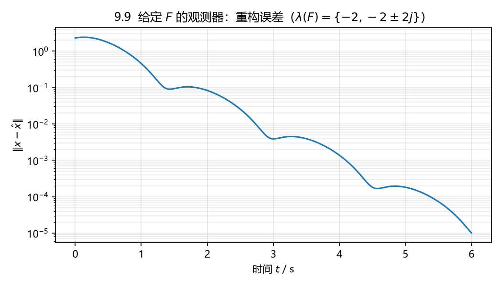

# 9.9 给定 $F$，确定观测器的 $G$、$H$、$M$

## 题目

设线性系统

$$
\dot x=\begin{bmatrix}-1&0&1\\2&0&2\\0&1&2\end{bmatrix}x
+\begin{bmatrix}0&1\\1&0\\0&1\end{bmatrix}u,\qquad
y=\begin{bmatrix}1&0&0\\0&0&1\end{bmatrix}x
$$

的一个观测器为

$$
\dot z=\begin{bmatrix}-2&0&0\\0&-2&2\\0&-2&-2\end{bmatrix}z+Gy+Hu,
\qquad
\hat x=Mz .
$$

请确定系数矩阵 $G$、$H$ 和 $M$。

## 答案

### 1）要满足的条件

把 $\hat x=Mz$ 和 $z=Tx$ 对比，观测器成立的条件是（(9.32)-(9.34) 在 $N=0$ 时的版本）

$$
H=TB,\qquad TA-FT=GC,\qquad MT=I_3 .
$$

先看可解性：$\det(sI-F)=(s+2)\big[(s+2)^2+4\big]$，$\lambda(F)=\{-2,-2\pm2\mathrm j\}$，
$\lambda(A)\approx\{2.875,\ -0.938\pm0.716\mathrm j\}$，两者不相交，Sylvester 方程
$TA-FT=GC$ 对每个 $G$ 都有唯一解 $T$。但这里 $T$、$G$、$M$ 都未知，方程数少于未知数，
**解不唯一**，下面取一组最简的。

### 2）先定 $T$

$y_1=x_1$、$y_2=x_3$ 是直接量到的，取 $T$ 的前两行为 $C$ 的两行，第三行待定：

$$
T=\begin{bmatrix}1&0&0\\0&0&1\\t&\tau_2&\tau_3\end{bmatrix}.
$$

$TA-FT=GC$ 要求 $TA-FT$ 的每一行都是 $C$ 的行的线性组合，即 $TA-FT$ 的**第 2 列必须为零**
（$\operatorname{null}(C)=\operatorname{span}\{e_2\}$）。算出

$$
TA-FT=\begin{bmatrix}1&0&1\\ -2t&1-2\tau_2&4-2\tau_3\\ t+2\tau_2&2\tau_2+\tau_3&t+2\tau_2+4\tau_3+2\end{bmatrix},
$$

$$
1-2\tau_2=0,\qquad 2\tau_2+\tau_3=0
\;\Longrightarrow\;
\tau_2=\tfrac12,\quad \tau_3=-1,\quad t\ \text{任意}.
$$

取 $t=0$：

$$
\boxed{T=\begin{bmatrix}1&0&0\\0&0&1\\0&\tfrac12&-1\end{bmatrix}},\qquad \det T=-\tfrac12\neq0 .
$$

### 3）回代求 $G$、$H$、$M$

$$
GC=TA-FT=\begin{bmatrix}1&0&1\\0&0&6\\1&0&-1\end{bmatrix}
\;\Longrightarrow\;
\boxed{G=\begin{bmatrix}1&1\\0&6\\1&-1\end{bmatrix}}
\qquad(\text{每行取 } C \text{ 两行的组合系数}),
$$

$$
\boxed{H=TB=\begin{bmatrix}0&1\\0&1\\\tfrac12&-1\end{bmatrix}},\qquad
\boxed{M=T^{-1}=\begin{bmatrix}1&0&0\\0&2&2\\0&1&0\end{bmatrix}} .
$$

于是观测器为

$$
\dot z=\begin{bmatrix}-2&0&0\\0&-2&2\\0&-2&-2\end{bmatrix}z
+\begin{bmatrix}1&1\\0&6\\1&-1\end{bmatrix}y
+\begin{bmatrix}0&1\\0&1\\\tfrac12&-1\end{bmatrix}u,
\qquad
\hat x=\begin{bmatrix}1&0&0\\0&2&2\\0&1&0\end{bmatrix}z
=\begin{bmatrix}z_1\\2z_2+2z_3\\z_2\end{bmatrix}.
$$

校验：$TA-FT-GC=0$、$MT=I_3$、$\lambda(F)=\{-2,-2\pm2\mathrm j\}$（Hurwitz，误差 $e=z-Tx$ 满足 $\dot e=Fe\to0$）。

### 4）解不唯一

$t$ 是自由的。$t=1$ 时

$$
T=\begin{bmatrix}1&0&0\\0&0&1\\1&\tfrac12&-1\end{bmatrix},\quad
G=\begin{bmatrix}1&1\\-2&6\\2&0\end{bmatrix},\quad
M=\begin{bmatrix}1&0&0\\-2&2&2\\0&1&0\end{bmatrix},
$$

同样是该系统的观测器。也就是说题目里的 $F$ 定下后，$(G,H,M)$ 还有一族解，上面 $t=0$ 那组是最简的。

## 数值验证

$x(0)=\begin{bmatrix}1&-2&0.5\end{bmatrix}^{\mathsf T}$，$z(0)=0$，$u=\begin{bmatrix}\sin t&\cos2t\end{bmatrix}^{\mathsf T}$，
仿真 6 s：$\|x-\hat x\|$ 从 2.29 降到 $1.0\times10^{-5}$（振荡包络按 $e^{-2t}$ 衰减）。



## 复算

```powershell
$py = 'D:\data\local\software\programming\Python\projects\.venv\Scripts\python.exe'
& $py 'D:\data\local\study\postgraduate\linear_system\projects\exercises\exports\ls_09\ex_9.py'
```

用到 `cal_observer_from_T`（已知 $F$、$T$ 反求 $G,H,M,N$）。
