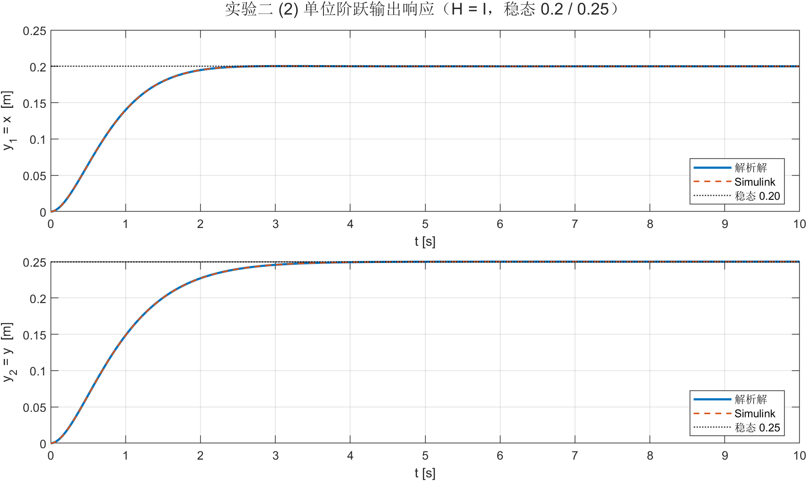
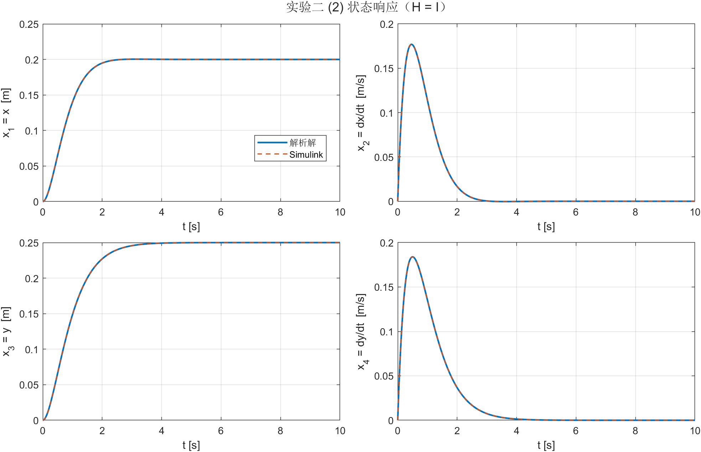
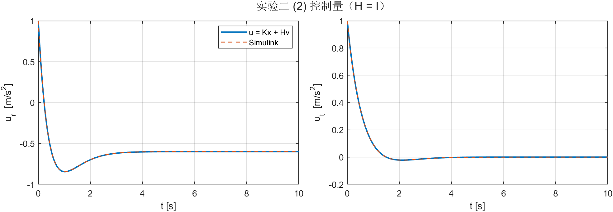
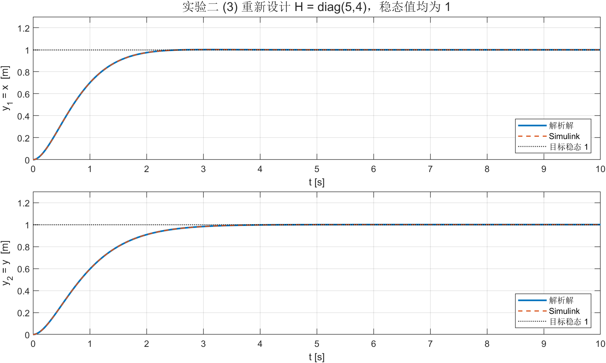
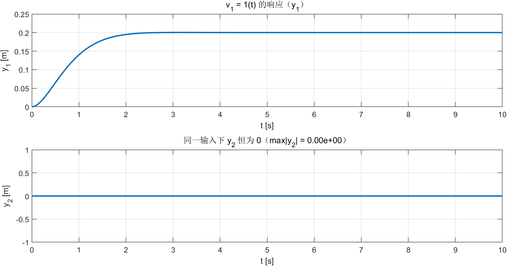

# 实验二 报告 · 卫星运动的输入输出解耦控制

**姓名 / 学号：** __________　　**班级：** __________　　**日期：** __________

---

## 一、实验目的

1. 掌握状态反馈解耦的条件（相对阶与解耦矩阵）；
2. 设计 $u=Kx+Hv$ 使闭环传递矩阵为指定对角阵；
3. 用 $H$ 调整直流增益，实现单位阶跃稳态为 1；
4. 用 Simulink 验证解耦效果。

## 二、实验内容与结果

### 1. 相对阶与解耦矩阵（$\omega=1$）

$$
y_1=x_1:\ \ddot y_1=3x_1+2x_4+u_r,\qquad
y_2=x_3:\ \ddot y_2=-2x_2+u_t
$$

$$
d_1=d_2=2,\qquad B^\ast=CAB=\begin{bmatrix}1&0\\0&1\end{bmatrix}\ \text{非奇异},\qquad \sum d_i=4=n
$$

无剩余动态，只要闭环按通道块对角即可完全解耦。

### 2. 解耦增益

$$
A+BK=\mathrm{blkdiag}\Big(\begin{bmatrix}0&1\\-5&-4\end{bmatrix},\begin{bmatrix}0&1\\-4&-4\end{bmatrix}\Big)
\;\Longrightarrow\;
K=\begin{bmatrix}-8&-4&0&-2\\0&2&-4&-4\end{bmatrix}
$$

闭环极点 $\{-2\pm j,-2,-2\}$，与 $1/(s^2+4s+5)$、$1/(s^2+4s+4)$ 的分母一致。

### 3. 验证 $G(s)$（$H=I$）

$$
G_{(K,H)}(s)=C(sI-A-BK)^{-1}BH=\frac{1}{s^2+4s+5}\oplus\frac{1}{s^2+4s+4}
$$

在 $s=0,0.5,1,2,1+2j,3j$ 上与目标的偏差 $<4.2\times10^{-17}$。

### 4. 单位阶跃响应

**(2) $H=I$，$v=[1(t),1(t)]^T$**：稳态 $G(0)=\mathrm{diag}(0.2,0.25)$。

| 项目 | 数值 |
|---|---|
| $y$ 稳态 | $0.2000,\ 0.2500$ |
| $\max|u_r|$ / $\max|u_t|$ | $1.0$ / $1.0$ |
| Simulink 与解析解偏差 | $x:8.5\times10^{-13}$，$y:3.5\times10^{-13}$，$u:1.4\times10^{-12}$ |

**(3) 稳态值改为 1**：取 $H=\mathrm{diag}(5,4)$，此时 $G(0)H=I_2$，两条曲线稳态均为 $1.000$，控制峰值 $5.0/4.0$。

**解耦效果**：只加 $v_1=1(t)$、$v_2=0$ 时 $y_1$ 正常响应，而 $y_2\equiv 0$（$\max|y_2|=0$）。

## 三、结论

1. 卫星系统两个输出相对阶都是 2，解耦矩阵为单位阵，满足静态状态反馈解耦的充要条件，且无剩余动态。
2. 让 $A+BK$ 按通道块对角即得解耦增益 $K$（正是实验一的 $K_2$）；$H=I$ 时闭环传递矩阵严格等于题目要求，$H=\mathrm{diag}(5,4)$ 可把稳态提到 1。
3. 解耦后两个通道完全独立（$v_1$ 不激励 $y_2$），仿真与解析解吻合到 $10^{-13}$。

---

## 四、2 分钟 PPT 页稿

**P1 标题（10 s）**
> 实验二：卫星的输入输出解耦控制。目标是把 $u=Kx+Hv$ 调成两个互不干扰的一维通道。

**P2 解耦条件（35 s）**
> 两个输出都是位置量，求导两次才出现控制量，所以相对阶都是 2；$CAB$ 是单位阵，非奇异，满足解耦条件。而且两个相对阶加起来正好是 4，等于系统阶数，说明没有剩余动态——这是最理想的情况，解耦之外还能随便配极点。

**P3 设计与验证（35 s）**
> 既然没有剩余动态，最直接的做法是让 $A+BK$ 变成两个二阶块，对应分母 $s^2+4s+5$ 和 $s^2+4s+4$；$B$ 的第 2、4 行是单位行，$K$ 直接从"目标矩阵减 $A$"里读出来。取 $H=I$，闭环传递矩阵就精确等于题目给的矩阵，数值验证误差 $10^{-17}$。

**P4 结果（30 s）**
> 但 $H=I$ 时稳态只有 0.2 和 0.25——因为两个二阶环节的直流增益分别是 1/5 和 1/4。要稳态为 1，把 $H$ 取成 $\mathrm{diag}(5,4)$ 就行。左边改后曲线，右边解耦验证：只加 $v_1$，$y_2$ 严格为零，说明两个通道真的独立了。

**P5 收尾（10 s）**
> 解耦增益 $K$ 恰好就是实验一那组"解耦型"的 $K_2$：实验一从极点配置出发、实验二从解耦出发，最后落在同一个矩阵上。

### 可能被问到的问题

1. **为什么相对阶之和 = n 就没有剩余动态？** 每个通道的输入-输出都占满 $d_i$ 个状态，合计 $n$ 个，系统没有"看不见"的零动态，因此极点可任意配置且解耦是精确的（不靠近似）。
2. **$H$ 改变了什么？** 只改参考到输入的增益（零点/直流增益），闭环极点（$A+BK$）不变，所以动态形状不变、稳态值成比例变化。
3. **如果 $B^\ast$ 奇异怎么办？** 那就要用动态解耦（加积分器/前馈补偿），静态状态反馈无法精确解耦。
