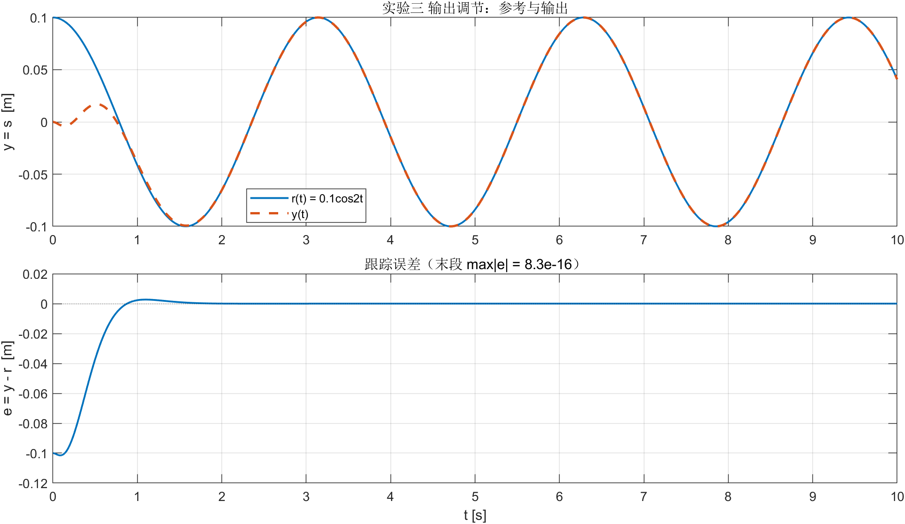
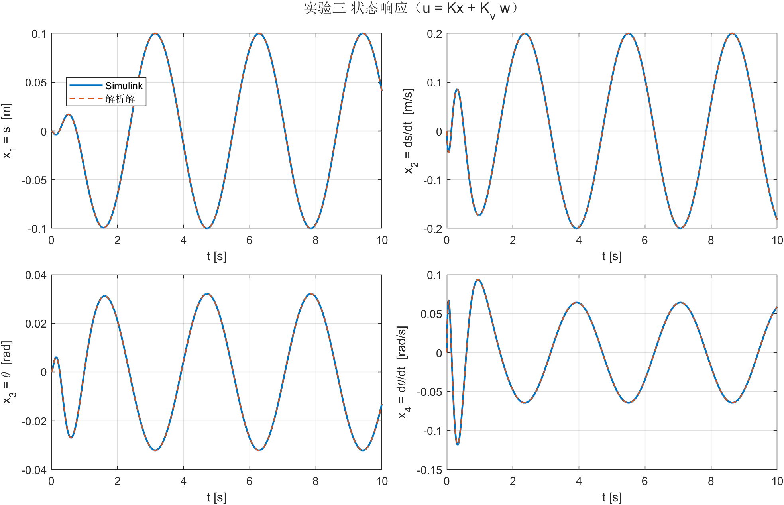
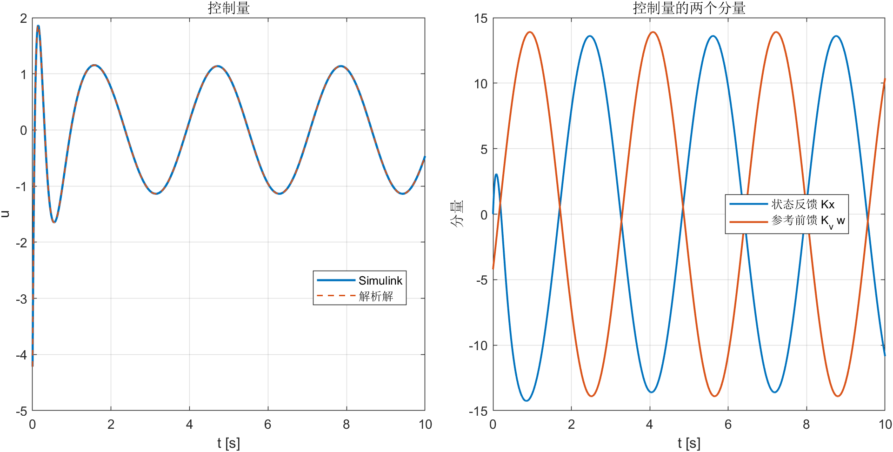

# 实验三 报告 · 倒立摆输出调节（静态状态反馈）

**姓名 / 学号：** __________　　**班级：** __________　　**日期：** __________

---

## 一、实验目的

1. 掌握输出调节的**静态状态反馈**方法：在 $u=Kx$ 之外，把参考发生器的状态 $w$ 经前馈 $K_v$ 引入；
2. 学会解**调节器方程**，理解它是"稳态渐近跟踪"的充要条件；
3. 用 Simulink 仿真 $r(t)=0.1\cos 2t$ 的跟踪过程，绘制 $r(t),y(t),x(t),u(t)$。

## 二、实验内容与结果

### 1. 被控对象与参考输入

$$
\dot x=Ax+Bu,\quad y=Cx,\quad x=[s,\dot s,\theta,\dot\theta]^T
$$

$$
A=\begin{bmatrix}0&1&0&0\\0&0&-3.267&0\\0&0&0&1\\0&0&19.6&0\end{bmatrix},\quad
B=\begin{bmatrix}0\\0.444\\0\\-0.667\end{bmatrix},\quad
C=\begin{bmatrix}1&0&0&0\end{bmatrix}
$$

开环极点 $\{0,0,\pm4.427\}$，不稳定。参考输入由外系统产生：

$$
\dot w=\begin{bmatrix}0&2\\-2&0\end{bmatrix}w,\quad w(0)=\begin{bmatrix}1\\0\end{bmatrix}
\;\Rightarrow\; w(t)=\begin{bmatrix}\cos2t\\-\sin2t\end{bmatrix},\quad
r(t)=\begin{bmatrix}0.1&0\end{bmatrix}w(t)=0.1\cos2t
$$

### 2. 调节器方程与静态控制律

设稳态 $x_{ss}=\Pi w$、$u_{ss}=\Gamma w$，代入对象并令稳态输出等于参考，得**调节器方程**

$$
\Pi A_v=A\Pi+B\Gamma,\qquad C\Pi=Q\quad(Q=[0.1\;0])
$$

解得

$$
\Pi=\begin{bmatrix}0.1&0\\0&0.2\\-0.032147&0\\0&-0.064294\end{bmatrix},\qquad
\Gamma=\begin{bmatrix}-1.137444&0\end{bmatrix}
$$

（残差 $\|\Pi A_v-A\Pi-B\Gamma\|_\infty=8.9\times10^{-16}$，$\|C\Pi-Q\|_\infty=1.7\times10^{-16}$。
能调节性判据：$\lambda=\pm2j$ 处 $\mathrm{rank}\begin{bmatrix}A-\lambda I&B\\C&0\end{bmatrix}=5=4+1$，通过。）

取 $u=Kx+K_vw$。极点配置（课件 4.4 公式，目标极点 $\{-5\pm3j,-5\pm2j\}$）得

$$
K=\begin{bmatrix}151.1502&96.5767&374.3789&94.2730\end{bmatrix}
$$

再由 $K_v=\Gamma-K\Pi$ 得

$$
K_v=\begin{bmatrix}-4.2172&-13.2541\end{bmatrix}
$$

**为什么这样就收敛**：令 $\xi=x-\Pi w$，则 $\dot\xi=(A+BK)\xi$（外系统项被方程抵消），$K$ 镇定 $\Rightarrow \xi\to0\Rightarrow y-r=C\xi\to0$，与初值无关。

### 3. Simulink 仿真结果

`ex_03_sim.slx` 按指导书图搭建（$w$ 发生器 → $k_v$ 前馈 + $k_x$ 状态反馈 → 对象），$T_f=10$ s。

| 指标 | 数值 |
|---|---|
| Simulink 与解析解 $e^{\begin{bmatrix}A+BK&BK_v\\0&A_v\end{bmatrix}t}z_0$ 的偏差 | 状态 $2.6\times10^{-11}$，控制 $1.7\times10^{-10}$，输出 $2.0\times10^{-12}$ |
| 跟踪误差 $\max|y-r|$（全程） | $0.1015$（$t=0$ 的初始偏差，约 1 s 衰减） |
| 跟踪误差 $\max|y-r|$（末段 $t>8$ s） | $8.3\times10^{-16}$ |
| 稳态状态误差 $\max|x-\Pi w|$（末段） | $1.3\times10^{-13}$ |
| 控制量 $\max|u|$ | $4.22$（$t=0$ 前馈冲击）；稳态幅值 $\approx1.14$ |

> 右上图右侧可见 $u=Kx+K_vw$ 的两个分量都在 $\pm13$ 左右、几乎反相 —— 大增益的"对消"正是输出调节的典型形态：状态反馈把瞬态压住，前馈把稳态撑起来，合起来的控制只有 1.1 量级。

## 三、结论

1. 静态状态反馈输出调节 = **极点配置**（管动态）+ **调节器方程**（管稳态）。$\Pi,\Gamma$ 解出后 $K_v=\Gamma-K\Pi$，外系统项在误差方程中被自动抵消，跟踪与初值无关。
2. 本系统在 $\pm2j$ 处无传输零点，能调节性判据通过；控制器 $K_v=[-4.2172,-13.2541]$，仿真的末段跟踪误差达 $8\times10^{-16}$（机器精度），稳态状态与 $\Pi w$ 吻合到 $10^{-13}$。
3. $K$ 只决定过渡过程快慢（这里 $\{-5\pm3j,-5\pm2j\}$，约 1 s 收敛），**不影响稳态精度**；课件给的 $k_x$ 与本文 $K$ 差 0.07%，同一组近似极点。
4. 课件图上标注的 $k_v=[-3.6786,-13.2353]$ 不满足 $C\Pi=Q$，若直接使用，稳态会出现 $3.9\times10^{-3}$ 的残余误差（幅值衰减 1.3%、相位滞后 $2.1^\circ$），说明 $K_v$ 不能凭"看着差不多"填。

---

## 四、2 分钟 PPT 页稿

**P1 标题页（10 s）**
> 实验三：倒立摆的输出调节，静态状态反馈。目标是让小车位置 $s$ 精确跟踪 $0.1\cos2t$，同时摆不能倒。

**P2 问题为什么不是"极点配置"（30 s）**
> 对象不稳定，$0,0,\pm4.4$。极点配置能把 $x$ 压到零，但我们要的不是零而是正弦。所以稳态不能是 0，得让状态跟着参考一起摆。
> 参考用外系统 $w'=[0\;2;-2\;0]w$ 产生，$w=[\cos2t;-\sin2t]$，$r=0.1w_1$。

**P3 调节器方程（40 s）**
> 设稳态 $x=\Pi w$、$u=\Gamma w$，代进对象就得到两条方程：$\Pi A_v=A\Pi+B\Gamma$ 和 $C\Pi=Q$。
> 手算就能解：$C\Pi=Q$ 直接给第一行 $[0.1\;0]$；第二列里关于 $\pi_{32}$ 的两个方程互相矛盾，逼出 $\gamma_2=0$；剩下的解出 $\gamma_1=-1.137$、$\pi_{31}=-0.032$。残差 $10^{-16}$。
> 控制律 $u=Kx+K_vw$，取 $K_v=\Gamma-K\Pi$。这样误差 $\xi=x-\Pi w$ 满足 $\dot\xi=(A+BK)\xi$，外系统被方程消掉，$K$ 镇定就收敛。

**P4 仿真（40 s）**
> 模型就是指导书那张图，$K$ 用极点配置 $[-5\pm3j,-5\pm2j]$。跟踪图：$y$ 从 0 起步，1 秒内贴住 $0.1\cos2t$，末段误差 $10^{-16}$ —— 等于数值零。
> 状态图里 $\theta$ 稳态幅度只有 0.032 rad，$\dot\theta$ 0.064，说明摆基本不动、全靠小车运动实现位置跟踪。
> 控制量图最有意思：$Kx$ 和 $K_vw$ 各自都有 $\pm13$，合起来只剩 1.1 —— 这就是输出调节的"对消"结构。

**P5 收尾（10 s）**
> 一句话：极点配置管瞬态，调节器方程管稳态。实验四把前馈换成内模，就能在没有 $w$ 可测的情况下也实现跟踪。

### 可能被问到的问题

1. **$\Pi$ 是什么物理意义？** 稳态时每个状态相对参考的"比例 + 相位"。$\Pi$ 第 1 行 $[0.1,0]$ 就是 $s$ 与 $r$ 同相；第 3 行 $-0.032$ 是摆角为了配合小车运动必须有的偏角。
2. **为什么 $\gamma_2=0$？** 第 2、4 行列出的 $\pi_{32}$ 与 $\gamma_2$ 的比例系数不同（$0.444/3.267\neq0.667/19.6$），只有 $\gamma_2=0$ 同时满足 —— 也就是外系统在第二分量上没有可用的输入通道。
3. **$K$ 换一组极点会怎样？** 过渡过程快慢变，$K_v$ 的具体数值也变（$K_v=\Gamma-K\Pi$ 里有 $K$），但 $\Pi,\Gamma$ 和稳态输出不变。
4. **能调节性判据不通过会怎样？** $\pm2j$ 处有传输零点时 $\Pi$ 无解，无论怎么选 $K$ 都无法精确跟踪（内模也救不了），必须改对象或改参考频率。
5. **初始误差 0.1 为什么不算"跟踪不好"？** 那是 $x(0)=0$ 与 $r(0)=0.1$ 的初始偏差，闭环极点实部 $-5$，$e^{-5t}$ 在 1 s 内就衰减到 $10^{-2}$ 以下，之后是机器精度。
