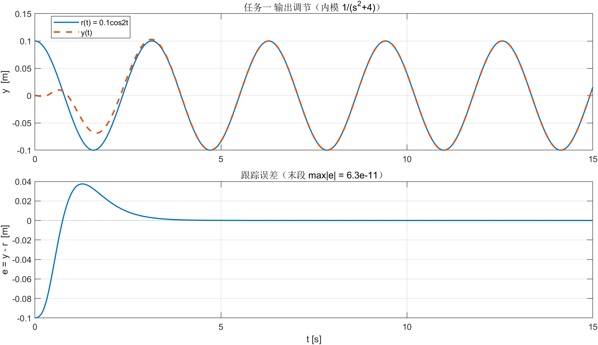
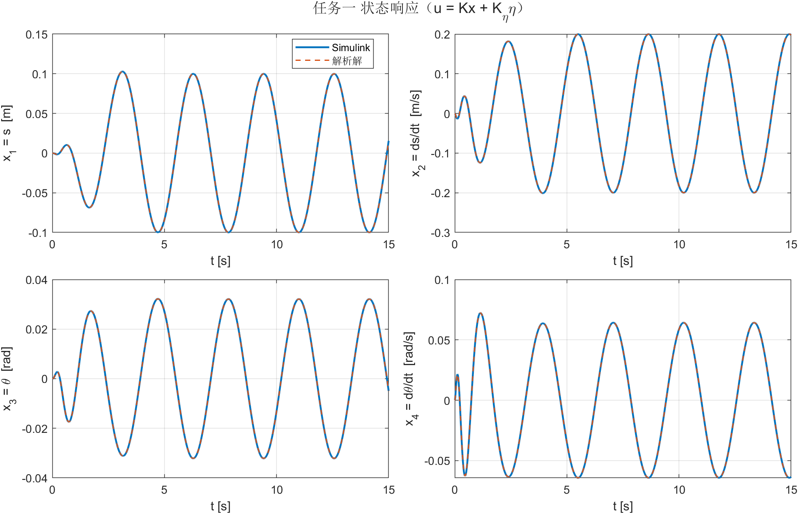
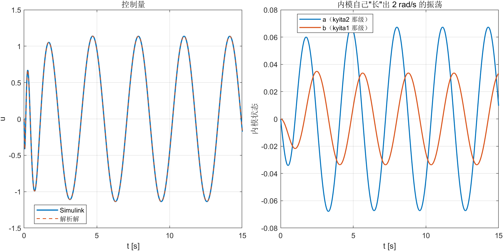
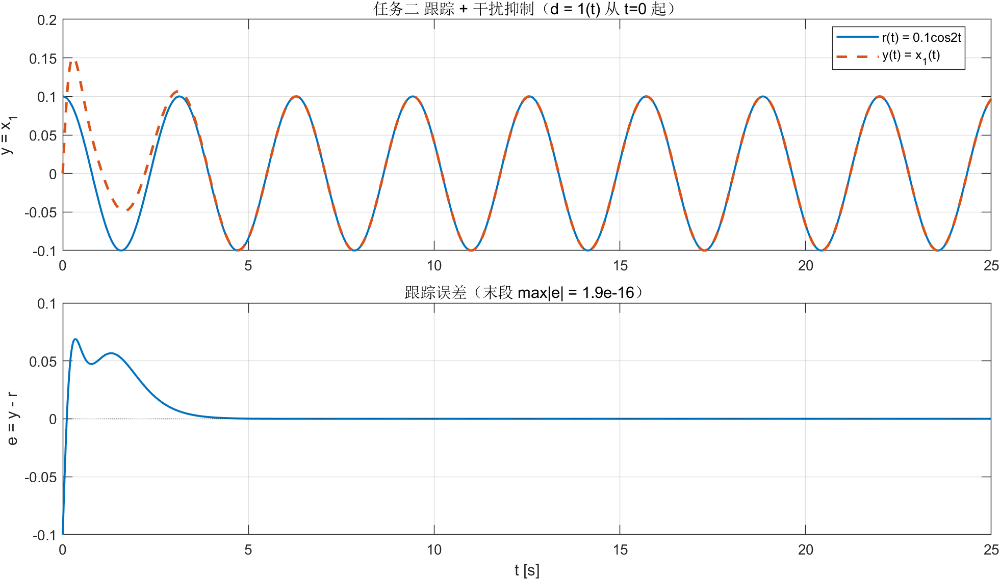
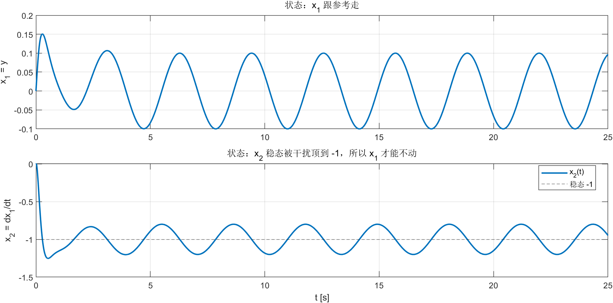
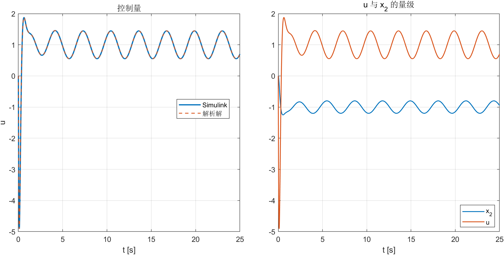

# 实验四 报告 · 输出调节（内模原理）

**姓名 / 学号：** __________　　**班级：** __________　　**日期：** __________

---

## 一、实验目的

1. 掌握输出调节的**内模原理**：不需要测量外系统状态 $w$，只把外系统的特征多项式做成补偿器，即可实现无静差跟踪；
2. 掌握"内模 + 对象"增广系统的极点配置（$K_{aug}=[K_x,K_\eta]$）；
3. 用 Simulink 完成两个任务：倒立摆跟踪 $0.1\cos2t$；二阶对象在 $d=1(t)$ 下跟踪 $0.1\cos2t$ 并抑制干扰。

## 二、实验内容与结果

### 1. 任务一：倒立摆输出调节（内模 $1/(s^2+4)$）

对象 $\dot x=Ax+Bu$、$y=[1\,0\,0\,0]x$，参考 $r(t)=0.1\cos2t$ 由 $w'=\begin{bmatrix}0&2\\-2&0\end{bmatrix}w$、$w(0)=[1,0]^T$ 产生。

补偿器取参考的模型（两级积分 + 反馈 $-4$）：

$$
a'=e-4b,\qquad b'=a,\qquad e=y-r
\;\Longrightarrow\;
\frac{b}{e}=\frac{1}{s^2+4}
$$

$$
u=k_xx+k_{\eta2}a+k_{\eta1}b,\qquad
\begin{bmatrix}x'\\a'\\b'\end{bmatrix}=
\begin{bmatrix}A&0&0\\C&0&-4\\0&1&0\end{bmatrix}
\begin{bmatrix}x\\a\\b\end{bmatrix}+
\begin{bmatrix}B\\0\\0\end{bmatrix}u+
\begin{bmatrix}0\\-1\\0\end{bmatrix}r
$$

对 6 阶增广系统做极点配置，期望极点 $\{-2,-3,-4,-5,-6,-7\}$：

$$
K_{aug}=\begin{bmatrix}k_x&k_{\eta2}&k_{\eta1}\end{bmatrix}
=[516.07,\;253.44,\;809.20,\;209.19,\;216.89,\;-1291.67]
$$

**离线校验**：$\left|\dfrac{e}{r}(j2)\right|=4.0\times10^{-16}$（内模把 $r$ 的频率吸收掉），
$\mathrm{eig}(A_{aug}+B_{aug}K_{aug})=\{-2,-3,-4,-5,-6,-7\}$。

**仿真**（$T_f=15$ s）：

| 指标 | 数值 |
|---|---|
| Simulink 与解析解（闭环 + 外系统增广 `expm`）偏差 | 状态 $2.9\times10^{-11}$，控制 $6.5\times10^{-10}$，输出 $1.5\times10^{-12}$ |
| $\max\lvert y-r\rvert$（全程 / 末段） | $0.100$（初值差） / $6.3\times10^{-11}$ |
| $\max\lvert u\rvert$ | $1.14$（但 $k_xx$ 与 $k_\eta\eta$ 各自 $\sim10^2$，靠对消） |

### 2. 任务二：渐近跟踪 + 干扰抑制（内模 $1/(s(s^2+4))$）

对象 $\dot x=\begin{bmatrix}0&1\\-2&2\end{bmatrix}x+\begin{bmatrix}0\\1\end{bmatrix}u+Ed$，$y=x_1$，
$r=0.1\cos2t$，$d=1(t)$。参考和干扰都要"进去"，所以内模取两者特征多项式之积：

$$
p'=e-4q,\qquad q'=p,\qquad s'=q
\;\Longrightarrow\;
\frac{q}{e}=\frac{1}{s^2+4},\qquad \frac{s}{e}=\frac{1}{s(s^2+4)}
$$

三级积分链一条就同时含 $1/(s^2+4)$（跟余弦）和 $1/s$（抗常值）。增广后 5 阶，期望极点 $\{-2,-3,-4,-5,-6\}$：

$$
K_{aug}=[k_{x1},\,k_{x2},\,k_{\eta3},\,k_{\eta2},\,k_{\eta1}]
=[-149,\;-22,\;-500,\;-440,\;-720]
$$

**离线校验**：$\left|\dfrac{e}{r}(j2)\right|=2.4\times10^{-16}$，$\left|\dfrac{e}{d}(0)\right|=0$。

**仿真**（$T_f=25$ s）：

| 指标 | 数值 |
|---|---|
| Simulink 与解析解偏差 | 控制 $1.1\times10^{-8}$，输出 $8.2\times10^{-11}$ |
| $\max\lvert y-r\rvert$（末段） | $1.9\times10^{-16}$ |
| $\max\lvert u\rvert$ / $\max\lvert x_2\rvert$ | $4.91$ / $1.25$ |
| $x_2$ 稳态 | 均值 $-0.97$，绕 $-1$ 波动 $\pm0.2$ |

> $x_2\to-1$ 是物理必然：$\dot x_1=x_2+d$，$d\equiv1$，要让 $x_1$ 跟着参考，就必须有 $x_2\approx-1$ 把干扰抵掉。这也是"抗扰"具体落在哪个状态上。

> 说明：手搭模型里 $d$ 的两路注入共用一个增益，等效 $E=[1;1]$；任务书为 $E=[1;2]$。内模含 $1/s$，对任意常值干扰都能抑到零，跟踪结论不变；若要严格对齐任务书，只需在 $x_2'$ 那一路单独接一个权重 2 的增益，$K$ 不用重算。

## 三、结论

1. **内模原理 = 把"外长什么样"写进控制器**。补偿器里放 $1/(s^2+4)$ 就能跟 $\cos2t$，再串一个 $1/s$ 就能吃常数干扰 —— 全程不需要测 $w$，只反馈 $e$。
2. 设计可以完全离线判稳/判跟：闭环极点 + 两个"零点判据"（$\lvert e/r(j2)\rvert$、$\lvert e/d(0)\rvert$）都为 $0$ 就一定能无静差；仿真只是印证，误差到 $10^{-11}\sim10^{-16}$。
3. 内模状态的量级很小（任务一 $a,b$ 只有 $0.03\sim0.07$），但增益到了 $10^3$，控制量靠"状态反馈 + 内模"大幅对消，稳态 $u$ 反而只有 $1.1$ —— 这与实验三的静态前馈是同一件事的两种写法。
4. 两个任务的差别只在"内模装了几阶"：任务一只需 $1/(s^2+4)$（2 阶），任务二要把干扰的 $1/s$ 也装进去（3 阶）。**内模的阶数 = 需要"记住"的外系统模态数。**

---

## 四、2 分钟 PPT 页稿

**P1 标题页（10 s）**
> 实验四：输出调节的内模原理。两个任务：倒立摆跟余弦；二阶系统在阶跃干扰下跟余弦。

**P2 为什么还要内模（30 s）**
> 实验三是静态前馈，要求 $w$ 可测。但工程上通常只知道误差 $e$。内模原理说：把外系统的特征多项式放进补偿器，就不用测 $w$ 了。
> 图上那两个积分器加 $-4$ 反馈，就是 $1/(s^2+4)$ —— 补偿器自己会"长出" $2\,\mathrm{rad/s}$ 的振荡。

**P3 任务一（40 s）**
> 6 阶增广系统，极点配到 $-2\ldots-7$，得到 $K=[516,253,809,209,217,-1292]$。
> 跟踪图：$y$ 从 0 起步，2.5 秒后完全贴住。误差 $6\times10^{-11}$。
> 右边这张最有意思：内模状态 $a,b$ 只有 $0.06$ 量级，可它能和 $k_xx$（$10^2$ 量级）对消，最后 $u$ 只有 $1.1$。

**P4 任务二（40 s）**
> 干扰是常值阶跃，参考是余弦，所以内模要装三阶：$1/(s(s^2+4))$。
> 5 阶极点配置，$K=[-149,-22,-500,-440,-720]$。
> 跟踪图：$y$ 先被干扰顶到 0.15，压回来之后误差 $10^{-16}$ —— 数值零。
> 状态图是关键：$x_2$ 稳到 $-1$，因为它要抵掉 $d$，$x_1$ 才能不动。

**P5 收尾（10 s）**
> 一句话：内模的阶数 = 需要记住的外系统模态数；装对了，误差就自动归零。

### 可能被问到的问题

1. **为什么任务一内模是 2 阶、任务二是 3 阶？** 任务一外系统只有 $A_v$（$\pm2j$）；任务二多了常值干扰（$0$ 特征值），特征多项式乘上 $s$，所以多一级积分。
2. **内模为什么用 $1/(s^2+4)$ 而不是 $1/(s+2j)$？** 必须用实系数多项式，共轭极点成对出现；单用复极点实现不出实系统。
3. **$K$ 里为什么内模分量比状态分量还大？** 内模状态幅值小（$10^{-2}$），要产生足够控制量就得大增益；另外内模极点靠近虚轴，把闭环拉快需要更大增益。
4. **$x_2$ 稳态 $-1$ 是不是跟踪失败了？** 不是。$y=x_1$ 才是输出；$\dot x_1=x_2+d$，$d=1$ 时 $x_2=-1$ 恰好使 $x_1$ 恒定，这是抗扰在状态上的体现。
5. **不用内模，直接把 $d$ 测出来前馈行不行？** 行但要求可测；内模的好处是只吃 $e$，且对同频干扰自动免疫。
