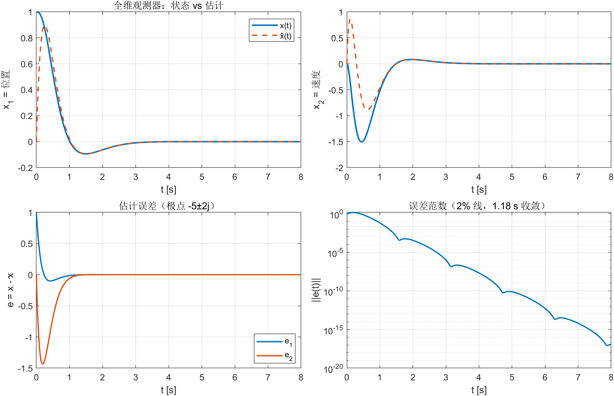
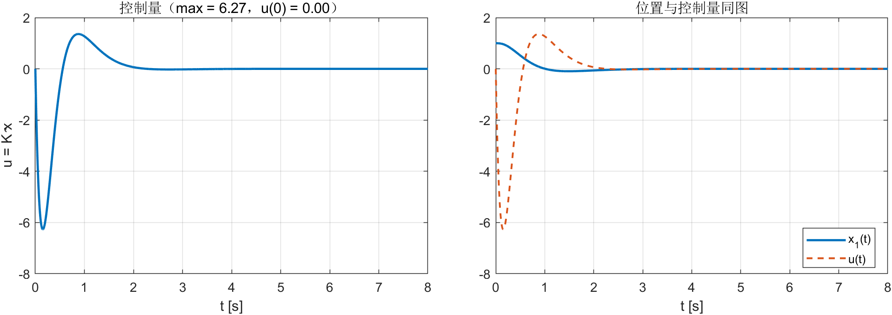
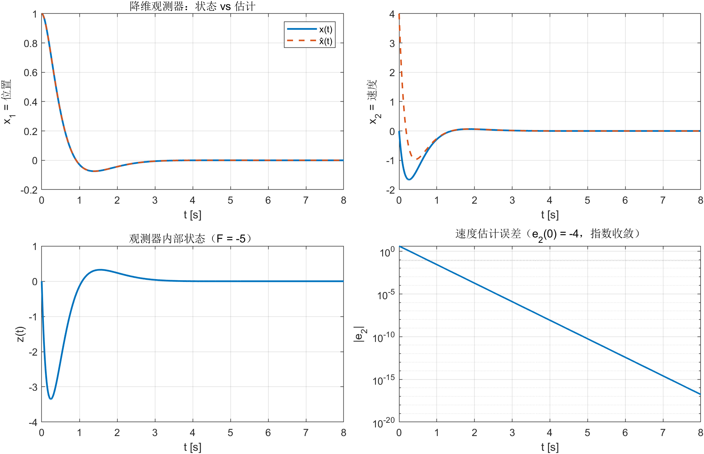
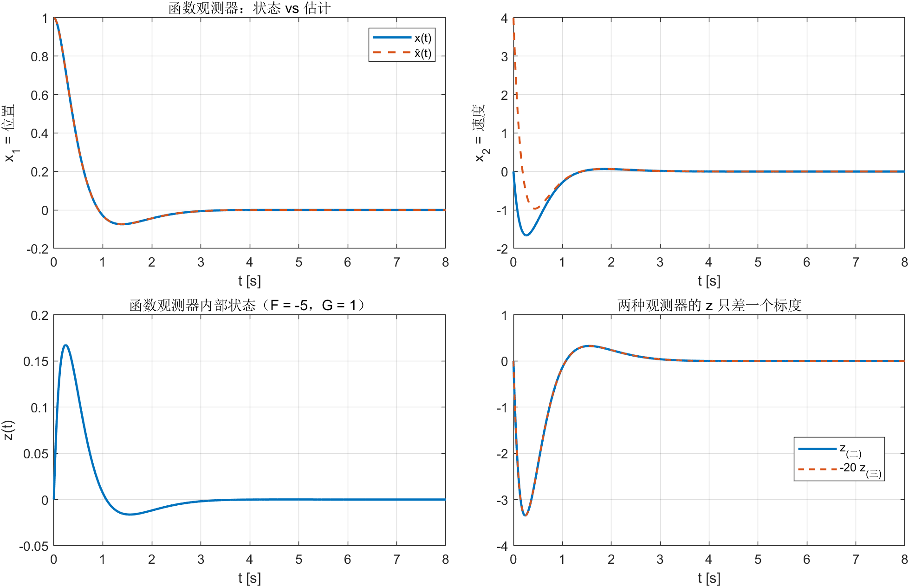
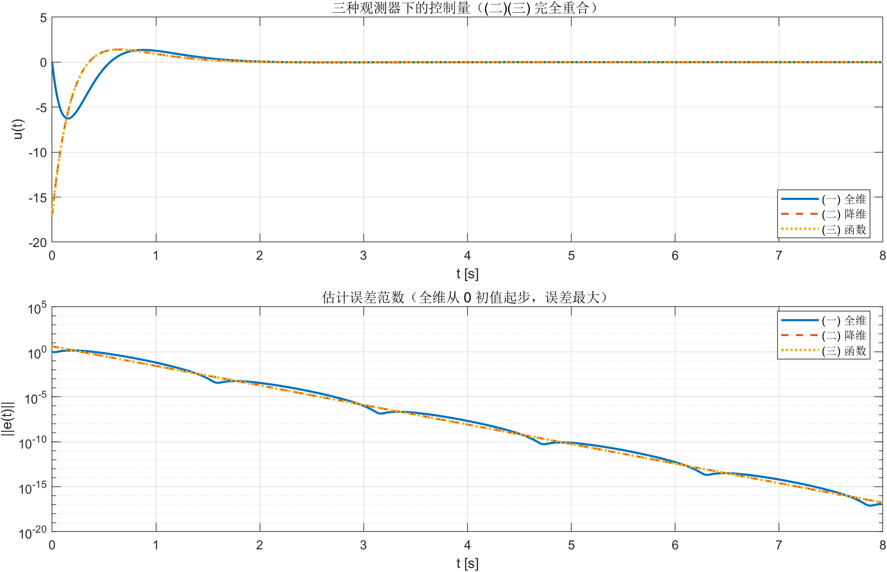
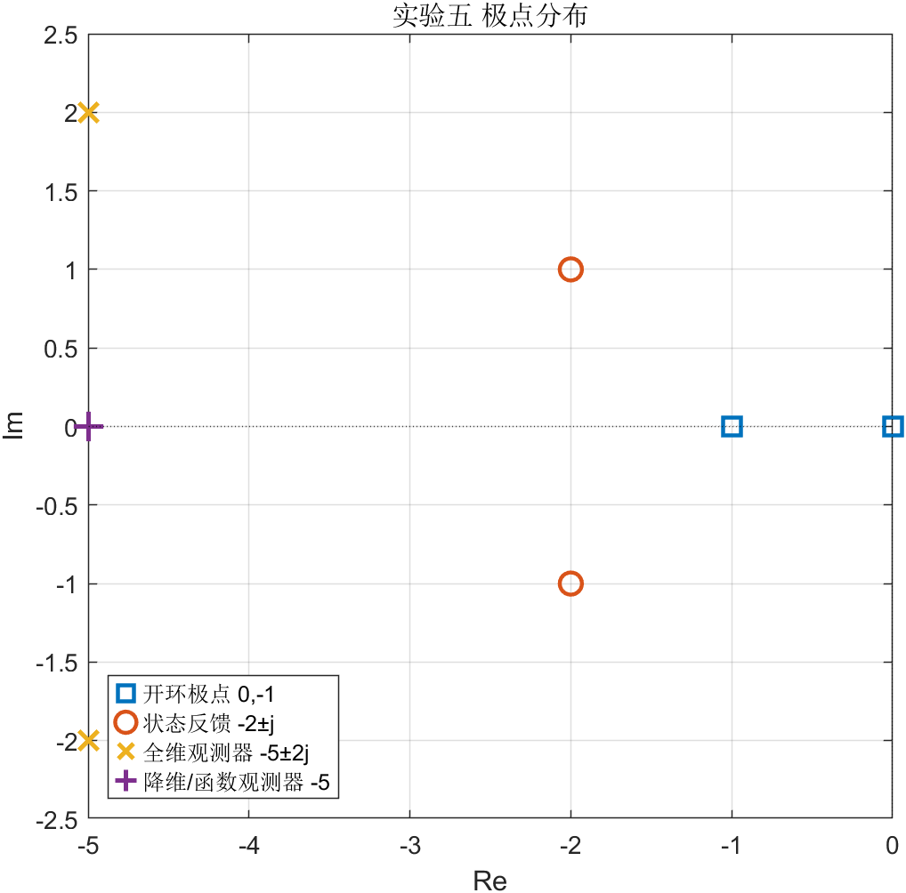

# 实验五 报告 · 全维/降维/函数观测器设计

**姓名 / 学号：** __________　　**班级：** __________　　**日期：** __________

> 任务书 `lab56` 一页含实验五、实验六两题，本报告按 **(一)(二)(三) 观测器设计 → 实验五** 划分。
> 任务书上的 Simulink 图只作仿真示例，本实验用解析解（$z(t)=e^{A_{cl}t}z_0$）完成全部仿真，
> 不搭模型，曲线与结论与 Simulink 等价（推导见 `bin/references/ex_05.md`）。

---

## 一、实验目的

1. 掌握全维、降维、函数三种状态观测器的设计方法；
2. 掌握"观测器 + 状态反馈"$u=K\hat x$ 的设计，并验证**分离原理**；
3. 掌握用 MATLAB / Python 辅助线性系统的建模、计算、分析与仿真；
4. 理解三种观测器之间的关系（阶数、误差极点、闭环等价性）。

## 二、实验对象

计算机磁盘驱动器磁头位置伺服，$x_1$ 磁头位置、$x_2$ 磁头速度、$u$ 直流电机推力：

$$
\dot x=\underbrace{\begin{bmatrix}0&1\\0&-1\end{bmatrix}}_{A}x+\underbrace{\begin{bmatrix}0\\1\end{bmatrix}}_{B}u,
\qquad y=\underbrace{\begin{bmatrix}1&0\end{bmatrix}}_{c}x
$$

开环极点 $\{0,-1\}$：一个积分器加一个一阶惯性，位置本身会漂，必须反馈。
能观性矩阵 $[c;\ cA]$ 的秩为 2，$(A,c)$ 能观，三种观测器都可设计。

状态反馈取任务书给定的 $K=[-5\ \ -3]$（$u=Kx$ 约定，闭环 $A+BK$）：

$$
A+BK=\begin{bmatrix}0&1\\-5&-4\end{bmatrix},\qquad \det(sI-A-BK)=s^2+4s+5\;\Rightarrow\;\lambda=-2\pm j
$$

本实验三组观测器的控制律都用 $u=K\hat x$，只换"$\hat x$ 怎么来"。

---

## 三、实验内容与结果

### 1. 全维状态观测器

**设计**（课件 9.1）：

$$
\hat x'=F\hat x+Gy+Hu,\qquad F=A+LC,\quad G=-L,\quad H=B
$$

误差 $e=x-\hat x$ 满足 $\dot e=Fe$；$L$ 由**对偶**极点配置给出：$L=K_{\text{dual}}^{\mathsf T}$，
$\lambda(A^{\mathsf T}+c^{\mathsf T}K_{\text{dual}})=\{$期望极点$\}$。取观测器极点 $-5\pm2j$（比闭环 $-2\pm j$ 快约 2.5 倍）：

$$
L=\begin{bmatrix}-9\\-20\end{bmatrix},\quad
F=\begin{bmatrix}-9&1\\-20&-1\end{bmatrix},\quad
G=\begin{bmatrix}9\\20\end{bmatrix},\quad
H=\begin{bmatrix}0\\1\end{bmatrix}
$$

（与任务书图上的 `F = [-9 1; -20 -1]`、`G = [9;20]` 一致。）

**闭环**（状态 $[x;\hat x]$）：

$$
A_{cl}=\begin{bmatrix}A&BK\\Gc&F+HK\end{bmatrix},\qquad
\lambda(A_{cl})=\underbrace{\{-2\pm j\}}_{\text{状态反馈}}\cup\underbrace{\{-5\pm2j\}}_{\text{观测器}}
$$

**仿真**：$x(0)=[1,0]^{\mathsf T}$（位置偏 1），$\hat x(0)=0$，故 $e(0)=x(0)$。



| 指标 | 数值 |
|---|---|
| $\max\lvert u\rvert$ / $u(0)$ | $6.27$ / $0$（控制器一开始"不知道"位置有偏差） |
| $\max\lVert e\rVert$ | $1.43$（二阶振荡，先冲高再收敛） |
| 误差衰减到 $2\%$ | $1.18$ s |
| 末段 $\max\lvert e\rvert$ | $3.5\times10^{-16}$（机器精度，指数收敛） |



### 2. 降维状态观测器

**设计**（课件 9.2，$q=n-p=1$）：

$$
F=A_{22}+L_{21}A_{12},\quad
G=A_{21}+L_{21}A_{11}-FL_{21},\quad
H=B_2+L_{21}B_1,
$$
$$
M=C_0(C_0^{\mathsf T}C_0)^{-1},\quad
N=c^{\mathsf T}(cc^{\mathsf T})^{-1}-ML_{21}
$$

$$
\dot z=Fz+Gy+Hu,\qquad \hat x=Mz+Ny
$$

本例 $c=[1,0]$，取 $C_0=[0,1]^{\mathsf T}$ 时坐标变换阵 $T_0=I$，分块就是 $A$ 自己：
$A_{11}=0,A_{12}=1,A_{21}=0,A_{22}=-1$，$B_1=0,B_2=1$。取误差极点 $-5$（即 $F=-5$），

$$
L_{21}=-4,\quad F=-5,\quad G=-20,\quad H=1,\quad
M=\begin{bmatrix}0\\1\end{bmatrix},\quad N=\begin{bmatrix}1\\4\end{bmatrix}
$$

$$
\hat x=\begin{bmatrix}y\\ z+4y\end{bmatrix},\qquad \dot z=-5z-20y+u
$$

$e_2=x_2-\hat x_2$ 满足 $\dot e_2=-5e_2$。重构恒等式
$ML_{21}+N-c^{\mathsf T}(cc^{\mathsf T})^{-1}\equiv0$（数值残差 0）。

**仿真**：$z(0)=0$ 时 $\hat x(0)=[1,4]^{\mathsf T}$ —— 位置直接由量测得到（无差），
速度估计初值为 4，所以初始误差 $e(0)=[0,-4]^{\mathsf T}$。



| 指标 | 数值 |
|---|---|
| $\hat x_2$ 的估计误差方程 | $\dot e_2=-5e_2$ |
| $\max\lvert u\rvert$ / $u(0)$ | $17.0$ / $-17$（初始速度估计偏大，控制器先反向拉一把） |
| $\max\lVert e\rVert$ | $4.00$ |
| 误差衰减到 $2\%$ | $0.78$ s |
| 末段 $\max\lvert e\rvert$ | $2.1\times10^{-16}$ |

### 3. 函数观测器

**设计**（课件 9.3/9.4）：只重构 $f=Rx$，本例 $R=K=[-5\ \ -3]$，即控制量本身。

$$
\dot z=Fz+Gy+Hu,\qquad \hat f=Mz+Ny
$$
$$
H=TB,\qquad TA-FT=Gc,\qquad M T+N c=R
$$

取 $(F,G)=(-5,\ 1)$（一阶、可控、Hurwitz），解 Sylvester 方程得

$$
T=\begin{bmatrix}0.2&-0.05\end{bmatrix},\qquad H=TB=-0.05
$$

再解 $[M\ N]\begin{bmatrix}T\\c\end{bmatrix}=R$：

$$
M=60,\qquad N=-17\qquad\Longrightarrow\qquad u=\hat f=60z-17y
$$

任务书图上画的是"先重构状态、再乘 $K$"，对应

$$
M_*=\begin{bmatrix}0\\-20\end{bmatrix},\quad N_*=\begin{bmatrix}1\\4\end{bmatrix}
\quad\text{（满足 }M_*T+N_*c=I_2\text{）}
$$

$$
u=K\hat x=K(M_*z+N_*y)=-5y-3(-20z+4y)=60z-17y
$$

两种写法完全等价（$K[M_*\ N_*]=[M\ N]$），仿真中两条路径的差为 $5.3\times10^{-15}$。



**与降维观测器的关系**：两者误差极点都是 $-5$，闭环极点同为 $\{-2\pm j,-5\}$，实测

$$
z_{(三)}=-\frac{1}{20}z_{(二)},\qquad \max\lvert u_{(三)}-u_{(二)}\rvert=1.1\times10^{-14}
$$

即**同一闭环、不同内部坐标**。按分离原理，闭环传递特性只取决于 $K$ 与误差极点，
观测器的"内部坐标系"不影响 $u(t)$、$x(t)$。

### 4. 三种观测器对比

| 观测器 | 阶数 | 误差极点 | 初值 | $\max\lvert u\rvert$ | $u(0)$ | $e$ 到 $2\%$ | 闭环极点 |
|---|---|---|---|---|---|---|---|
| (一) 全维 | 2 | $-5\pm2j$ | $\hat x(0)=0$ | $6.27$ | $0$ | $1.18$ s | $\{-2\pm j\}\cup\{-5\pm2j\}$ |
| (二) 降维 | 1 | $-5$ | $z(0)=0$ | $17.0$ | $-17$ | $0.78$ s | $\{-2\pm j,-5\}$ |
| (三) 函数 | 1 | $-5$ | $z(0)=0$ | $17.0$ | $-17$ | $0.78$ s | $\{-2\pm j,-5\}$ |





三组曲线不完全重合，差别**只来自初始估计误差**（全维从 $\hat x(0)=0$ 起步，误差最大；
降维/函数的位置估计直接取量测，只有速度有初始偏差），不是设计优劣。

---

## 四、结论

1. 三种观测器都精确满足**分离原理**：闭环极点 $=$ 状态反馈极点 $\cup$ 观测器极点，
   误差极点可独立配置（本例 $-5\pm2j$ 与 $-5$，均比状态反馈的 $-2\pm j$ 快）。
2. 降维观测器只用一个积分器，就能从 $y$ 重构速度：$z$ 的误差按 $e^{-5t}$ 衰减，
   $\hat x=[y;\ z+4y]$ 中位置部分直接取量测，无估计误差。
3. 函数观测器把设计目标从"重构状态"降为"重构 $Kx$"（$u=60z-17y$）；本例 $n-p=1$ 已最小，
   其闭环与降维观测器完全等价，差别仅是 $z$ 的坐标标度（$z_{(三)}=-z_{(二)}/20$）。
4. 工程含义：观测器初值误差会经 $u=K\hat x$ 直接进入控制量（降维/函数在 $t=0$ 就有
   $u=-17$），实际系统需要给更接近真值的初值或加限幅。

---

## 五、2 分钟 PPT 页稿

**P1 标题（10 s）**
> 实验五：磁盘驱动器磁头的观测器设计。一条结论先放这儿：三种观测器（全维、降维、函数）都能把状态/控制量估出来，闭环极点都是"状态反馈极点 $+$ 观测器极点"，分离原理成立。

**P2 对象与状态反馈（25 s）**
> 对象是磁头位置和速度，$A=\begin{bmatrix}0&1\\0&-1\end{bmatrix}$、$B=[0;1]$、$y=x_1$，开环有一个积分器，位置会漂。状态反馈取任务书给的 $K=[-5,-3]$，闭环极点 $-2\pm j$。现在的任务是：四个状态里只能量到 $x_1$，怎么得到 $x_2$。

**P3 全维与降维（45 s）**
> 全维：$\hat x'=A\hat x+L(y-\hat x_1)$，误差是 $\dot e=(A+Lc)e$，用对偶极点配置把误差极点放在 $-5\pm2j$，得 $L=[-9;-20]$，跟任务书图上的 $F$、$G$ 完全对上。
> 降维：位置已经量到了，只需要估速度。用课件 9.2 的公式，取误差极点 $-5$，得到 $F=-5$、$G=-20$、$H=1$、$M=[0;1]$、$N=[1;4]$，也就是 $\hat x_2=z+4y$。

**P4 函数观测器（25 s）**
> 函数观测器更省事：只重构 $Kx$。取 $F=-5,G=1$，解 Sylvester 方程得到 $H=-0.05$，最后控制律就是 $u=60z-17y$——一个积分器加两个增益，直接把控制量算出来，不用重构两个状态。
> 有个有意思的结果：它和降维观测器的 $u(t)$ 逐点相同，因为两者误差极点一样，只是内部坐标差了 $-20$ 倍。分离原理只认极点，不认坐标。

**P5 结果与结论（20 s）**
> 图上是三组响应：全维初值全 0，误差最大但 $u(0)=0$；降维/函数一开始就知道位置错了，$u(0)=-17$，收敛更快（0.78 s vs 1.18 s）。三种都收敛到机器精度。结论：三种观测器都是同一个分离原理的不同实现，工程上按"能测什么、要估什么、算力/初值怎么给"选型。

### 可能被问到的问题

1. **$L$ 怎么来的？** 对偶极点配置：$L=K^{\mathsf T}$，其中 $K$ 是把 $A^{\mathsf T}+c^{\mathsf T}K$ 的极点配到 $-5\pm2j$ 的增益；直接算也得到 $[-9;-20]$。
2. **降维观测器为什么 $z(0)=0$ 时 $\hat x_2(0)=4$？** 因为 $\hat x_2=z+4y$，$y(0)=1$，所以 $z(0)=0$ 对应初值 4。这是"故意给一个错的初值"以便观察收敛；想让估计从真值出发取 $z(0)=-4$。
3. **函数观测器的 $M_*=[0;-20]$ 怎么来的？** 由 $M_*T+N_*c=I$ 解得，$T=[0.2,-0.05]$，所以 $M_*$ 第二行 $=1/(-0.05)=-20$，$N_*$ 第二行 $=-(-20)(0.2)=4$。
4. **为什么 $u$ 的峰值 $17$ 比全维大？** 初始速度估计误差 4，控制器按错误估计给出 $-17$；全维一开始 $\hat x=0$，反而"不敢动"。

---

## 六、复现

```powershell
$py = 'D:\data\local\software\programming\Python\projects\.venv\Scripts\python.exe'
& $py experiments\src\ex_05\ex_05_design.py
matlab -batch "cd('experiments'); run('src/ex_05/ex_05_main.m')"
```

产物：`bin/data/ex_05/`（5 组图 + `ex_05_data.mat` + `ex_05_log.txt`）。
