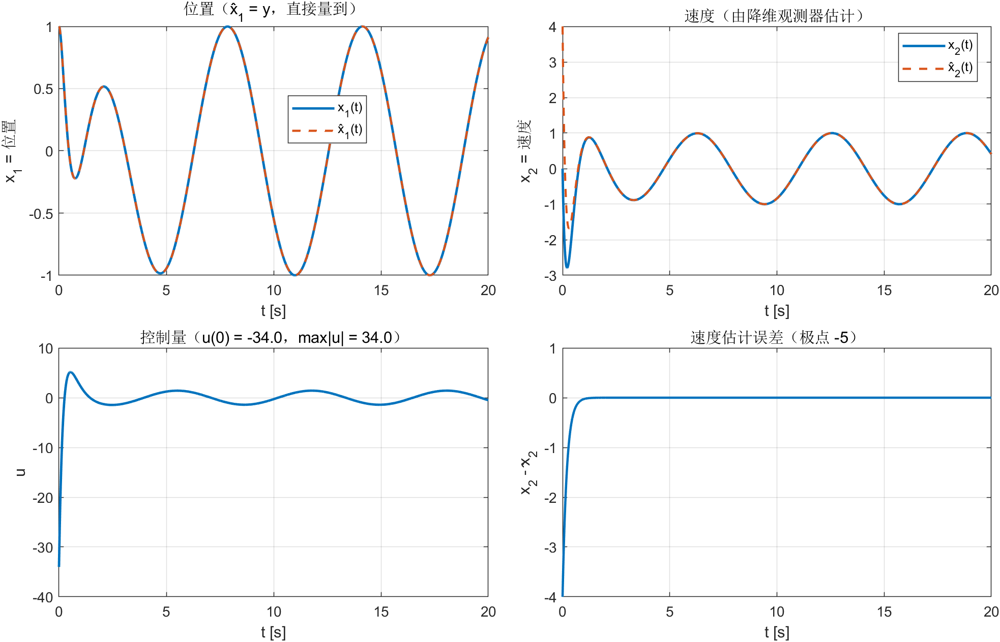
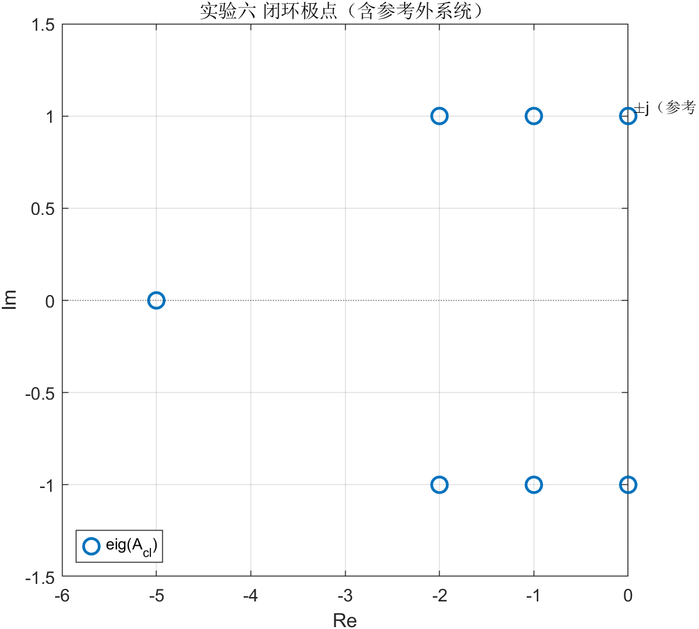
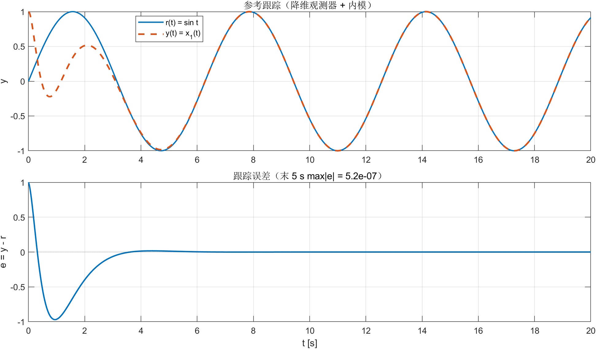
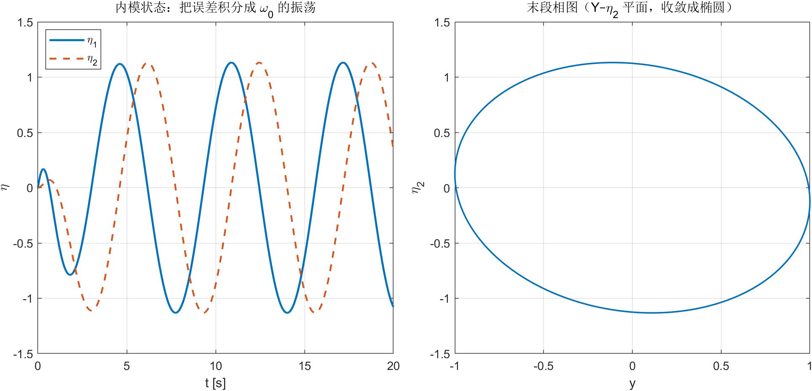
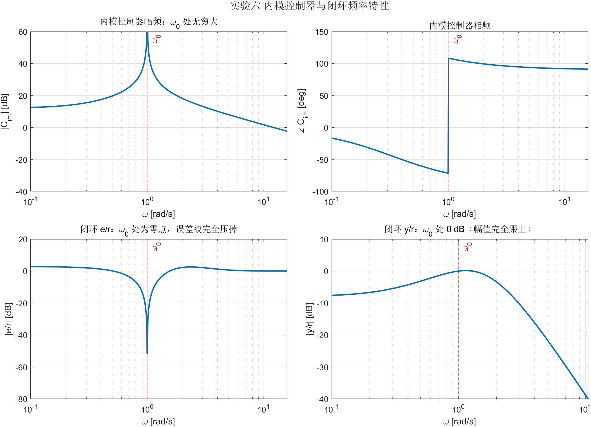

# 实验六 报告 · 观测器与状态反馈（降维观测器 + 内模原理的渐近跟踪）

**姓名 / 学号：** __________　　**班级：** __________　　**日期：** __________

> 任务书 `lab56` 中第 (四) 题：降维观测器与渐近跟踪（内模原理）。本报告按 **(四) → 实验六** 划分。
> 与实验五相同，任务书上的 Simulink 图只作示例，本实验用 7 维闭环的解析解
> $z(t)=e^{A_{cl}t}z_0$ 完成仿真；Bode 图由传递函数矩阵直接算。

---

## 一、实验目的

1. 掌握内模原理（internal model principle）的设计方法：把外系统的特征多项式放进控制器；
2. 掌握"降维观测器 + 动态状态反馈"的组合设计，并验证**分离原理**仍然成立；
3. 掌握内模控制器的 Bode 图与闭环频率特性分析；
4. 对比实验四（静态/动态输出调节），理解"内模跟踪"与"状态反馈"的分工。

## 二、问题描述

磁盘上的数据不完全在中心圆上，伺服系统必须跟踪一个角频率为 $\omega_0$（磁盘自转速度）的正弦输入：

$$
\ddot r=-\omega_0^2 r\;\Longrightarrow\; r(t)=\sin(\omega_0 t),\qquad \omega_0=1\ \mathrm{rad/s}
$$

被控对象仍为实验五的磁头位置/速度模型：

$$
\dot x=\begin{bmatrix}0&1\\0&-1\end{bmatrix}x+\begin{bmatrix}0\\1\end{bmatrix}u,\qquad
y=\begin{bmatrix}1&0\end{bmatrix}x
$$

要求：(1) 降维观测器 + 动态状态反馈；(2) 仿真并画 $r,y,u,x,\hat x$；(3) 画内模控制器的 Bode 图。

---

## 三、设计与结果

### 1. 内模 1/(s²+1)

参考由自治外系统生成：$w'=A_rw,\ r=C_rw$，

$$
A_r=\begin{bmatrix}0&1\\-1&0\end{bmatrix},\quad C_r=\begin{bmatrix}1&0\end{bmatrix},\quad
w(0)=\begin{bmatrix}0\\1\end{bmatrix}\;\Rightarrow\;w=\begin{bmatrix}\sin t\\\cos t\end{bmatrix}
$$

内模取外系统特征多项式 $s^2+1$ 的实现（与实验四的 $1/(s^2+4)$ 同一写法，只是频率不同）：

$$
\dot\eta=A_c\eta+B_ce,\qquad
A_c=\begin{bmatrix}0&-1\\1&0\end{bmatrix},\quad B_c=\begin{bmatrix}1\\0\end{bmatrix},\qquad e=y-r
$$

即 $\eta_1'=e-\eta_2,\ \eta_2'=\eta_1$。任务书图上 `W = -1` 的增益就是 $A_c$ 里的 $-\omega_0^2$。

### 2. 增广系统极点配置

$$
A_{aug}=\begin{bmatrix}A&0\\B_c c&A_c\end{bmatrix},\qquad
B_{aug}=\begin{bmatrix}B\\0\end{bmatrix},\qquad
z_e=\begin{bmatrix}x\\\eta\end{bmatrix}
$$

$(A_{aug},B_{aug})$ 能控（$\mathrm{rank}=4=2+2$）。期望极点取**状态反馈那一对** $\{-2\pm j\}$
加**内模那一对** $\{-1\pm j\}$：

$$
K_{aug}=\begin{bmatrix}K_x&K_\eta\end{bmatrix}
=\begin{bmatrix}-14&-5&-12&4\end{bmatrix}
$$

$$
u=K_x\hat x+K_\eta\eta=-14\hat x_1-5\hat x_2-12\eta_1+4\eta_2
$$

与任务书图上的 `KX = [-14 -5]`、`KYITA2 = -12`（乘 $\eta_1$）、`KYITA1 = 4`（乘 $\eta_2$）一致。
验证：$\lambda(A_{aug}+B_{aug}K_{aug})=\{-2\pm j,-1\pm j\}$。

### 3. 降维观测器

沿用实验五任务二的观测器（误差极点 $-5$）：

$$
F=-5,\quad G=-20,\quad H=1,\quad
M=\begin{bmatrix}0\\1\end{bmatrix},\quad N=\begin{bmatrix}1\\4\end{bmatrix},\qquad
\hat x=Mz+Ny=\begin{bmatrix}y\\ z+4y\end{bmatrix}
$$



### 4. 闭环极点与两个原理

把参考外系统也并进状态，$z=[x;\ z_{obs};\ \eta;\ w]$ 共 7 维，闭环为齐次系统 $\dot z=A_{cl}z$：

$$
\lambda(A_{cl})=\underbrace{\{-2\pm j\}}_{\text{状态反馈}}\cup
\underbrace{\{-1\pm j\}}_{\text{内模}}\cup
\underbrace{\{-5\}}_{\text{观测器误差}}\cup
\underbrace{\{\pm j\}}_{\text{参考外系统}}
$$

- **分离原理**：观测器误差极点 $-5$ 与 $[x;\eta]$ 的极点解耦，所以可以用估计状态代替真实状态；
- **内模原理**：内模在闭环里，只要闭环（除 $\pm j$ 外）稳定，则 $e\to0$。
  注意 $\pm j$ 是**外系统自己的极点**，不是闭环不稳定——输出是正弦，但误差为零。



时域验证：末 5 s $\max\lvert y-r\rvert=5.2\times10^{-7}$，$\max\lvert \hat x-x\rvert=6.4\times10^{-15}$，
末段幅值比 $\max\lvert y\rvert/\max\lvert r\rvert=1.0000$。

### 5. 时域仿真结果

初值：$x(0)=[1,0]^{\mathsf T}$（位置偏 1）、$z(0)=0$（对应 $\hat x(0)=[1,4]^{\mathsf T}$）、$\eta(0)=0$。



| 指标 | 数值 |
|---|---|
| 闭环极点 | $-2\pm j,\ -1\pm j,\ -5,\ \pm j$ |
| 末 5 s $\max\lvert y-r\rvert$ | $5.2\times10^{-7}$ |
| 末段幅值比 | $1.0000$（幅值无差） |
| $u(0)$ / $\max\lvert u\rvert$ | $-34$ / $34$ |
| 稳态 $\max\lvert u\rvert$ | $1.414=\sqrt2$ |
| 内模状态稳态幅值 | $\max\lvert\eta_1\rvert=\max\lvert\eta_2\rvert=1.13$ |

**$u(0)=-34$ 的解释**：观测器内部状态取 $z(0)=0$，对应速度估计 $\hat x_2(0)=4$，
真实速度是 0；控制器按"磁头正在以 4 的速度运动"给出很大的反向控制，约 1 s 内观测器
把速度估计修正（误差极点 $-5$），控制量回落到稳态的 $\sqrt2$ 量级。这说明**观测器初值误差
会直接进入控制量**——工程上要给更准的初值（如 $z(0)=-4$ 使 $\hat x(0)=x(0)$）或加限幅。

### 6. 内模状态：控制器里的"参考镜像"



稳态时 $e\to0$，内模已不再被误差驱动，但 $\eta$ 并不衰减：它被参考外系统"驱动"成同频正弦
（幅值 $1.13$、与 $r$ 有固定相位差），相当于控制器里保存的参考镜像——正因为有它，
即使 $e\approx0$，$u=K_x\hat x+K_\eta\eta$ 仍能输出跟踪所需的周期性控制分量。

### 7. 频域：内模控制器的 Bode 图

内模控制器（控制量中由内模产生的那部分，从 $e$ 到 $u$ 的动态环节）：

$$
C_{im}(s)=K_\eta(sI-A_c)^{-1}B_c
=\frac{k_{\eta1}s+k_{\eta2}}{s^2+\omega_0^2}
=\frac{4-12s}{s^2+1}
$$

在 $\omega=\omega_0=1$ 处分母为零、分子 $4-12j\neq0$，故 $\lvert C_{im}(j\omega_0)\rvert\to\infty$。



上图四个子图：

1. $\lvert C_{im}\rvert$：$\omega_0$ 处增益无穷大（图中因频率点避开了 $\omega=1$，峰是有限的）；
2. $\angle C_{im}$：过 $\omega_0$ 时相位翻转 $180^\circ$；
3. 闭环 $\lvert e/r\rvert$：$\omega_0$ 处**零点**，实测 $\lvert e/r(j1)\rvert=3.5\times10^{-16}$；
4. 闭环 $\lvert y/r\rvert$：$\omega_0$ 处 $0$ dB，实测 $1.0000$——幅值完全跟得上。

> 频率网格取点时避开了恰好 $\omega=1$（否则幅值 $\to\infty$ 画不出来），所以图上峰/谷是有限值，
> 但竖直红虚线标出的正是 $\omega_0$，与仿真结论一致。

---

## 四、结论

1. 内模 $1/(s^2+1)$ 把参考的正弦模态"装进"控制器后，闭环极点可任意配置到
   $\{-2\pm j,-1\pm j,-5\}$，而 $\pm j$ 保留为外系统极点；稳态误差 $e\to0$（实测 $5\times10^{-7}$），
   幅值比 $1.0000$。
2. 降维观测器与内模可以分别设计（分离原理）：观测器误差极点 $-5$ 与 $[x;\eta]$ 解耦，
   用 $\hat x$ 替代 $x$ 不影响内模跟踪。
3. 内模控制器 $C_{im}(s)=\dfrac{4-12s}{s^2+1}$ 在 $\omega_0$ 处增益无穷大，闭环
   $e/r$ 在 $\omega_0$ 处有零点、$y/r$ 为 $0$ dB——时域与频域两条判据互相印证。
4. 内模状态稳态不衰减，而是被参考驱动成同频正弦，是控制器中"参考的镜像"；
   观测器初值误差会在 $t=0$ 产生 $u=-34$ 的尖峰，实际系统需限幅或更准确的初值。
5. 与实验四对比：实验四用**静态**状态反馈（$u=Kx+K_vw$，需要 $w$ 可测）；本实验用**动态**
   内模反馈（只需 $e$），代价是控制器多两阶动态，且要画/看 Bode 图确认 $\omega_0$ 处增益。

---

## 五、2 分钟 PPT 页稿

**P1 标题（10 s）**
> 实验六：观测器加状态反馈，用内模原理跟踪 $\sin t$。一句话结论：内模把参考频率放在控制器里，闭环稳定就能做到零稳态误差，Bode 图上表现为 $\omega_0$ 处控制器增益无穷大、闭环 $e/r$ 出现零点。

**P2 对象与问题（25 s）**
> 对象还是实验五的磁头模型，$y=x_1$，速度测不到，所以用降维观测器；参考是磁盘自转引起的正弦，$\omega_0=1$。要求 $y$ 跟住 $r$，而不是回到零。

**P3 内模 + 增广极点配置（40 s）**
> 内模就是 $\eta'=A_c\eta+B_ce$，$A_c$ 由 $s^2+1$ 构造（图上那个 $W=-1$ 就是 $-\omega_0^2$）。把对象和内模拼成 4 阶增广系统，极点配到 $-2\pm j$ 和 $-1\pm j$，得 $K=[-14,-5,-12,4]$——前两个乘观测状态，后两个乘内模状态。闭环极点再加上观测器的 $-5$，参考外系统的 $\pm j$ 保留在外系统里。

**P4 结果（30 s）**
> 时域：稳态误差 $5\times10^{-7}$，幅值比 1.0000。$u$ 在 $t=0$ 有 $-34$ 的尖峰，是观测器初值给错速度估计造成的，1 秒内修正。内模状态稳态不衰减，被参考驱动成同频正弦，相当于控制器里存了个参考的镜像。
> 频域：内模控制器 $C_{im}=\frac{4-12s}{s^2+1}$，$\omega_0$ 处增益无穷大；闭环 $e/r$ 在该频率是零点、$y/r$ 是 0 dB，和时域完全对得上。

**P5 结论（15 s）**
> 两句话：分离原理让观测器和内模各配各的；内模原理让"零稳态误差"变成两个可验证的结论——时域误差趋于零，频域在 $\omega_0$ 处有零点/无穷大增益。

### 可能被问到的问题

1. **内模为什么能消掉稳态误差？** 把 $e$ 积分的是内模（含 $1/(s^2+1)$）；闭环稳定后，$e$ 的稳态响应只能是该频率的"响应"，而内模在 $\omega_0$ 处增益无穷大，迫使 $e$ 的该频率分量为零（Bode 图上的零点）。
2. **$\pm j$ 极点为什么不算不稳定？** 它们属于参考外系统 $w'=A_rw$，不是闭环内部模态；$w$ 是外部信号，$\pm j$ 上的模态就是 $y$ 跟踪的正弦。闭环"内部"模态（$x,\eta$ 相对于稳态解的部分）都是左半平面。
3. **$u(0)$ 为什么是 $-34$？** $\hat x(0)=[1,4]$，$K_x\hat x=-14-20=-34$，内模初值为 0。改 $z(0)=-4$ 可以让观测初值正确、尖峰消失。
4. **为什么用 $1/(s^2+1)$ 而不是 $1/(s^2+4)$？** 内模必须与参考的生成器匹配：参考 $r=\sin t$ 的特征多项式是 $s^2+1$；频率不匹配就消不掉该频率的误差。
5. **和实验四有什么区别？** 实验四的参考/干扰由外系统给出且状态可测，用静态状态反馈 $u=Kx+K_vw$；本实验只用误差 $e$ 驱动内模（动态反馈），不需要知道 $w$，代价是控制器升阶。

---

## 六、复现

```powershell
$py = 'D:\data\local\software\programming\Python\projects\.venv\Scripts\python.exe'
& $py experiments\src\ex_06\ex_06_design.py
matlab -batch "cd('experiments'); run('src/ex_06/ex_06_main.m')"
```

产物：`bin/data/ex_06/`（5 组图 + `ex_06_data.mat` + `ex_06_log.txt`）。
