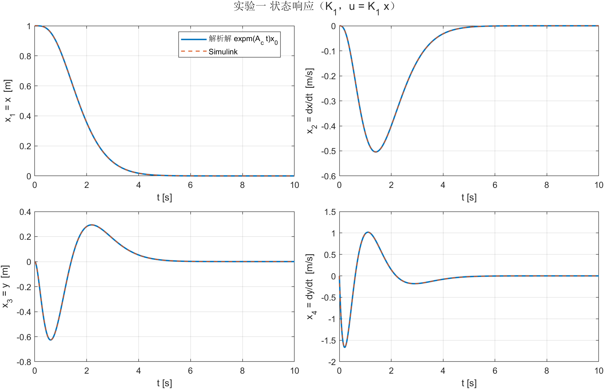
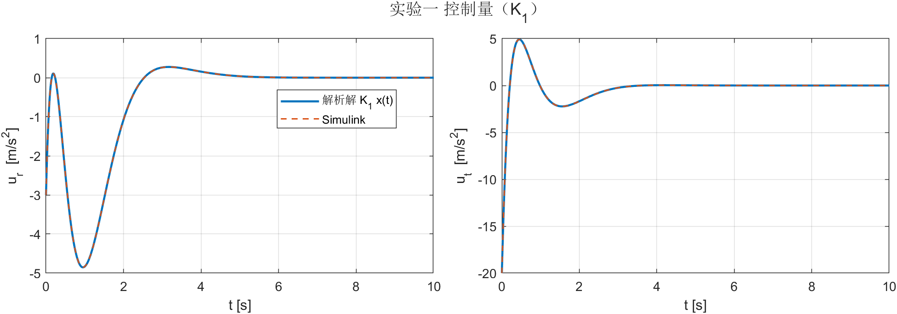
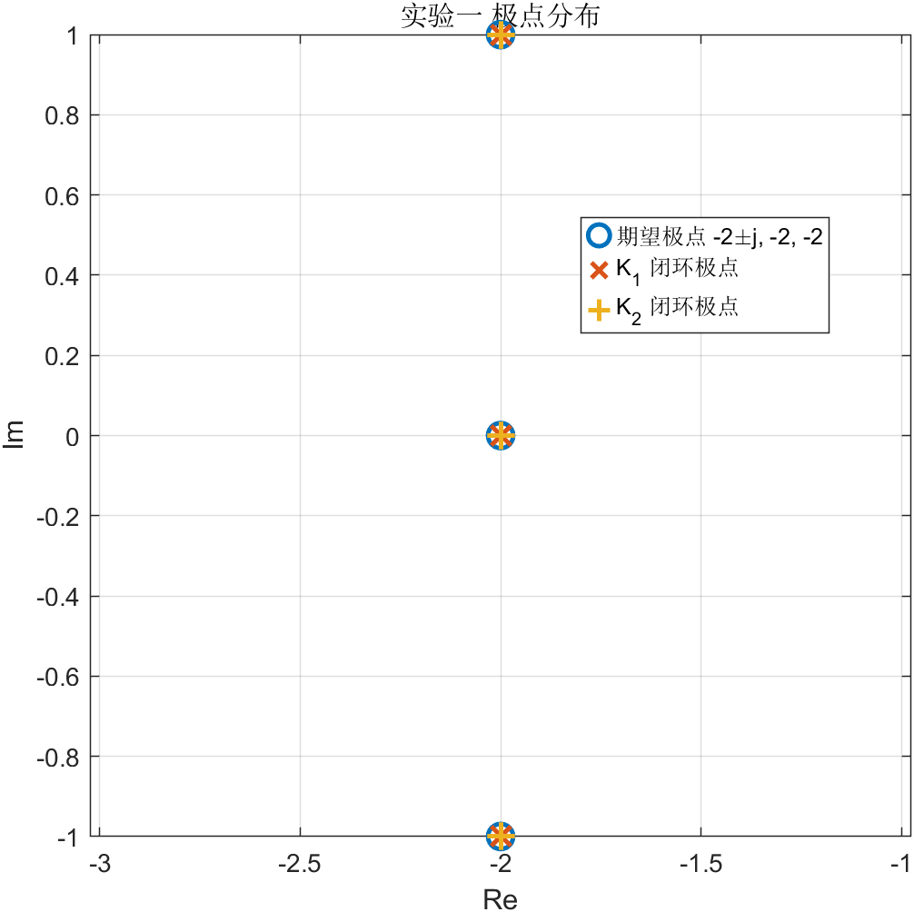
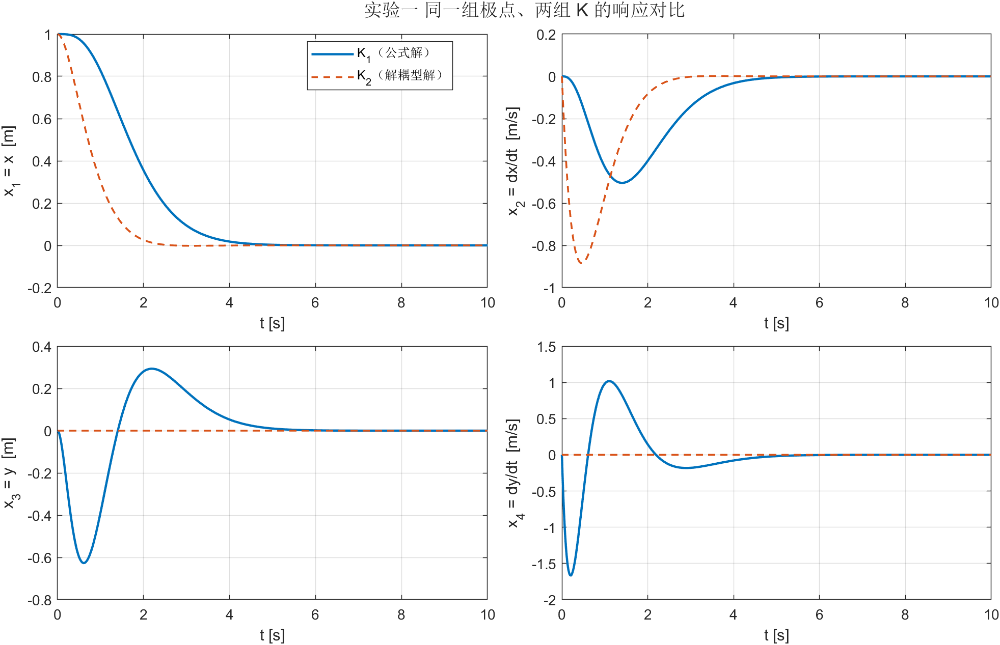

# 实验一 · 卫星运动的状态反馈极点配置

> 课程：线性系统（哈工大）　|　实验一：状态反馈极点配置
> 代码：`experiments/src/ex_01/`　|　结果：`experiments/bin/data/ex_01/`
> 说明：任务书最后那个"机床滑动台"页是老师给的**报告示例**（自选工程背景），不属于必做内容，本报告按卫星本体完成。

---

## 0. 结论速览

| 项目 | 结果 |
|---|---|
| 状态模型 | $\dot x = Ax + Bu$，$x=[x,\dot x,y,\dot y]^T$，$u=[u_r,u_t]^T$ |
| 两路推力 | $\mathrm{rank}\,\mathcal{C} = 4$，能控 |
| 仅径向 $u_r$ | $\mathrm{rank} = 3$，**不能控**（丢失 $y$ 方向的漂移模态，$\lambda = 0$） |
| 仅切向 $u_t$ | $\mathrm{rank} = 4$，能控 |
| 第一组 $K$（$4.4$ 公式） | $K_1=\begin{bmatrix}-3&0&1&-2\\-20&-34&-25&-8\end{bmatrix}$ |
| 第二组 $K$（解耦型块对角） | $K_2=\begin{bmatrix}-8&-4&0&-2\\0&2&-4&-4\end{bmatrix}$ |
| 闭环极点（两组） | $\{-2\pm j,\;-2,\;-2\}$，特征多项式偏差 $<3\times10^{-14}$ |
| Simulink 与解析解 | 最大偏差 $8.7\times10^{-11}$（状态）／$2.4\times10^{-10}$（控制） |

---

## 1. 实验目的

1. 建立卫星相对运动的状态空间模型；
2. 用 $\mathrm{rank}(\mathcal{C})$ 判别能控性；
3. 设计状态反馈 $u=Kx$ 使闭环极点 $\{-2\pm j,-2,-2\}$，并体会**多输入极点配置解不唯一**；
4. 计算并仿真初始状态响应 $x(t)$、$u(t)$。

---

## 2. 状态空间模型（任务 1）

卫星在赤道圆轨道上的相对运动（C-W / Hill 方程，径向 $x$、切向 $y$）：

$$
\ddot x - 2\omega\dot y - 3\omega^2 x = u_r,\qquad
\ddot y + 2\omega\dot x = u_t
$$

取状态 $x=[x,\dot x,y,\dot y]^T$、输入 $u=[u_r,u_t]^T$、输出 $y_{\text{out}}=[x,y]^T$，整理得

$$
\dot x=\underbrace{\begin{bmatrix}
0&1&0&0\\
3\omega^2&0&0&2\omega\\
0&0&0&1\\
0&-2\omega&0&0
\end{bmatrix}}_{A}x+
\underbrace{\begin{bmatrix}
0&0\\1&0\\0&0\\0&1
\end{bmatrix}}_{B}u,
\qquad
C=\begin{bmatrix}1&0&0&0\\0&0&1&0\end{bmatrix},\; D=0
$$

**开环特性**（$u=0$）：

$$
\det(sI-A)=s^2\big(s^2+\omega^2\big)\;\Longrightarrow\;\lambda(A)=\{0,\,0,\,\pm j\omega\}
$$

即"沿轨道方向的自由漂移（二重零极点）+ 无阻尼振荡"，是典型的临界稳定系统，必须靠反馈镇定。

取 $\omega=1\ \mathrm{rad/s}$（题目要求的设计值）时

$$
A=\begin{bmatrix}0&1&0&0\\3&0&0&2\\0&0&0&1\\0&-2&0&0\end{bmatrix},\qquad B=\begin{bmatrix}0&0\\1&0\\0&0\\0&1\end{bmatrix}
$$

---

## 3. 能控性（任务 2、3）

能控性矩阵 $\mathcal{C}=[B,AB,A^2B,A^3B]$：

| 发动机工况 | $B$ 的列 | $\mathrm{rank}\,\mathcal{C}$ | 结论 |
|---|---|---|---|
| 两路推力同时工作 | $[b_1,b_2]$ | 4 | 能控，可任意配置极点 |
| 仅径向 $u_r$ | $b_1=e_2$ | **3** | 不能控 |
| 仅切向 $u_t$ | $b_2=e_4$ | 4 | 能控 |

$\omega=0.0011\ \mathrm{rad/s}$（实际 250 海里轨道）时秩仍是 $4/3/4$：**能控性与 $\omega$ 无关**（只要 $\omega\neq0$）。

### 3.1 仅径向时到底丢了什么模态？

对 $(A,b_1)$ 求 $\mathcal{C}^T$ 的左零空间，得 $w\propto[2,0,0,1]^T$，满足

$$
w^T A=0\cdot w^T,\qquad w^T b_1=0,\qquad \mathrm{rank}[A-\lambda I,\;b_1]=3<4
$$

即不可控模态为 $\lambda=0$，对应右特征向量 $v=e_3=[0,0,1,0]^T$。物理含义很直白：

> 径向发动机只能改变 $x$、$\dot x$，它不出现在 $\ddot y+2\omega\dot x=u_t$ 的右端；  
> 所以**切向位置 $y$ 的常值漂移无法被 $u_r$ 拉回**——推得再狠，卫星也只是在径向"弹"一下，切向位置永远回不到零。

反过来，切向发动机能通过 $2\omega\dot x$ 这一项"借"到径向运动，因此 $(A,b_2)$ 能控。

---

## 4. 两组状态反馈增益（任务 4）

目标极点 $\{-2\pm j,-2,-2\}$，对应

$$
\gamma(s)=(s+2)^2\big[(s+2)^2+1\big]=s^4+8s^3+25s^2+36s+20
$$

统一约定 $u=Kx$，闭环矩阵 $A+BK$（与课件第 4 章一致；若改用 $u=-Kx$，把 $K$ 取负即可）。

### 4.1 第一组：课件 4.4 极点配置公式

**能控性指数集**按幂次逐层扫（$b_1,b_2,Ab_1,Ab_2,\dots$）得到

$$
\nu=(2,2),\qquad
Q=[\,b_1\;Ab_1\,|\,b_2\;Ab_2\,]=
\begin{bmatrix}0&1&0&0\\1&0&0&2\\0&0&0&1\\0&-2&1&0\end{bmatrix}
$$

$p_i$ 取 $Q^{-1}$ 第 $\nu_1+\cdots+\nu_i$ 行：$p_1=[1,0,0,0]$，$p_2=[0,0,1,0]$。于是

$$
T=\begin{bmatrix}p_1\\p_1A\\p_2\\p_2A\end{bmatrix}=I_4,\qquad
\tau=\begin{bmatrix}p_1AB\\p_2AB\end{bmatrix}=I_2,\qquad
\gamma^\ast=-[\,20,36,25,8\,]
$$

（这一例里 $T$、$\tau$ 恰好为单位阵，推导特别干净。）

$$
K_1=\tau^{-1}\Big(\underbrace{\begin{bmatrix}p_2\\\gamma^\ast T\end{bmatrix}}_{S}
-\underbrace{\begin{bmatrix}p_1A^2\\p_2A^2\end{bmatrix}}_{\text{pa}}\Big)
=\begin{bmatrix}0&0&1&0\\-20&-36&-25&-8\end{bmatrix}
-\begin{bmatrix}3&0&0&2\\0&-2&0&0\end{bmatrix}
=\begin{bmatrix}-3&0&1&-2\\-20&-34&-25&-8\end{bmatrix}
$$

### 4.2 第二组：解耦型块对角解

既然要的是两组共轭/重极点，最自然的另一组解是让闭环矩阵**按两个子系统块对角**：

$$
A+BK_2=\mathrm{blkdiag}\Big(\begin{bmatrix}0&1\\-5&-4\end{bmatrix},
\begin{bmatrix}0&1\\-4&-4\end{bmatrix}\Big)
$$

两个块的特征多项式分别是 $s^2+4s+5=(s+2)^2+1\Rightarrow-2\pm j$ 与 $s^2+4s+4=(s+2)^2\Rightarrow-2,-2$，正好是题目要求的集合。由于 $B$ 只有第 2、4 行非零，$BK$ 只影响这两行，直接从 $(\text{blkdiag}-A)$ 的第 2、4 行读出：

$$
K_2=\begin{bmatrix}-8&-4&0&-2\\0&2&-4&-4\end{bmatrix}
$$

这组解还顺带把 $x$ 通道与 $y$ 通道解耦了（下一节图 4 里 $y\equiv0$），正是**实验二**要用的结构。

### 4.3 验证

| | 闭环特征多项式 | 与期望的偏差 | $\lambda(A+BK)$ |
|---|---|---|---|
| $K_1$ | $s^4+8s^3+25s^2+36s+20$ | $2.5\times10^{-14}$ | $-2,\,-2,\,-2\pm j$ |
| $K_2$ | $s^4+8s^3+25s^2+36s+20$ | $1.4\times10^{-14}$ | $-2,\,-2,\,-2\pm j$ |

### 4.4 为什么会有"两个不同的 $K$"？

$K$ 是 $2\times4$ 矩阵，共 **8 个未知量**；而"闭环特征值等于给定集合"只给 **4 个方程**（特征多项式系数 $\gamma_{n-1},\dots,\gamma_0$）。$8>4$，所以解是一个 **4 维解族**，$K_1$、$K_2$ 只是其中两点（$\|K_1-K_2\|=46.8$）。

这也解释了 MATLAB 的 `place` 给出的第三组 $K$ 为什么又不一样（$\|K-K_1\|=36.8$）。注意 **`place` 的约定是 $A-BK$**，要在本报告的 $u=Kx$ 约定下用它，必须取负号，否则极点全错。

---

## 5. 初始状态响应（任务 5）

取初始状态 $x_0=[1,0,0,0]^T$（径向偏 1 m），$T_f=10$ s，$u=K_1x$：

$$
x(t)=e^{(A+BK_1)t}x_0,\qquad u(t)=K_1x(t)
$$





| 指标（$K_1$） | 数值 |
|---|---|
| $\max|u_r|$ | $4.85\ \mathrm{m/s^2}$ |
| $\max|u_t|$ | $20.0\ \mathrm{m/s^2}$ |
| $2\%$ 调节时间 | $5.06$ s |
| 末端 $\|x(10)\|$ | $1.7\times10^{-6}$ |

**Simulink 对照**：模型 `ex_01_sim.slx`（State-Space + 增益 $K$ 反馈，`x_sim`/`u_sim` 输出到工作区）与解析解

- $K_1$：状态偏差 $8.7\times10^{-11}$，控制偏差 $2.4\times10^{-10}$
- $K_2$：状态偏差 $2.7\times10^{-12}$，控制偏差 $5.3\times10^{-12}$

两者在图上完全重合，说明"解析解 + 模型 + 反馈增益"三者自洽。

### 极点分布与两组 $K$ 的对比





图 4 很能说明问题：**极点相同、过渡过程完全不同**。

- $K_1$ 让 $x\to y$ 之间有耦合，径向一偏，切向跟着荡出 $0.63$ m（$t\approx0.6$ s 时最大）；
- $K_2$ 直接把两个通道拆开，$y(t)\equiv0$，径向独立收敛。

这就是"极点只决定收敛快慢，特征向量才决定各状态怎么动"的直观体现，也是实验二解耦控制的出发点。

---

## 6. 结论

1. 卫星相对运动模型开环有 $0,0,\pm j\omega$，临界稳定，必须状态反馈镇定；两路推力能控，**只有径向推力时不能控**（丢失 $y$ 的漂移模态）。
2. 用课件 4.4 公式得到 $K_1$，用解耦型块对角设计得到 $K_2$，两组都精确实现 $\{-2\pm j,-2,-2\}$，验证了多输入系统极点配置**解不唯一**。
3. 初始状态响应解析解（$e^{A_ct}$）与 Simulink 仿真吻合到 $10^{-10}$ 量级。
4. 工程提示：$K_1$ 的 $u_t$ 峰值达 $20\ \mathrm{m/s^2}$（径向 $4.85$），而 $K_2$ 的 $u_t$ 只有 $1.77\ \mathrm{m/s^2}$（径向升到 $8$）且完全不激励切向通道——同样极点下，**解的选择直接影响执行机构负担与过渡过程**。

---

## 7. 复现

```powershell
# 1) 设计计算（Python，复用 linear_system_utils 库）
& 'D:\data\local\software\programming\Python\projects\.venv\Scripts\python.exe' experiments\src\ex_01\ex_01_design.py

# 2) 仿真、画图、写日志（MATLAB，跑你手搭的 ex_01_sim.slx）
matlab -batch "cd('experiments'); run('src/ex_01/ex_01_main.m')"
```

产物：`experiments/bin/data/ex_01/`（4 张图 + `ex_01_data.mat` + `ex_01_log.txt`）。

> 提示：Simulink 的 Gain 模块乘法方式必须是 `Matrix(K*u)`（Element-wise 对 $2\times4$ 乘 $4\times1$ 会报维数错）；`State-Space` 的 `X0` 要由脚本注入（$x_0\neq0$）。脚本只在内存里改这两处，**不会保存你的 .slx**。

---

## 8. 文件清单

| 文件 | 作用 |
|---|---|
| `src/ex_01/ex_01_design.py` | 模型、能控性、两组 $K$；调用 linear_system_utils，输出 JSON |
| `src/ex_01/ex_01_design.json` | 设计结果（供 MATLAB 读取） |
| `src/ex_01/ex_01_main.m` | 复核 + 解析响应 + 跑 Simulink + 出图 + 写日志 |
| `src/ex_01/ex_01_run_sim.m` | 给 `ex_01_sim.slx` 灌参数并仿真（不改磁盘文件） |
| `src/ex_01/ex_01_sim.slx` | 手搭的 Simulink 模型（State-Space + $K$ 反馈） |
| `src/common/initial_state_response.m` | 解析初始状态响应 $e^{A_ct}x_0$ |
| `common` 中已删除 | `controllability_index.m`、`pole_placement_duan.m`（与 linear_system_utils 重复） |

---

## 附：2 分钟 PPT 提纲（4 页）

1. **模型**：C-W 方程 → $A,B$；开环极点 $0,0,\pm j$，临界稳定。
2. **能控性**：秩表；仅径向丢 $y$ 漂移模态（$w\propto[2,0,0,1]^T$，$v=e_3$）。
3. **两组 $K$**：公式解 vs 解耦型；同一个特征多项式，$\|K_1-K_2\|=46.8$ → 解不唯一。
4. **曲线**：解析 vs Simulink（重合，误差 $10^{-10}$）；$K_1/K_2$ 对比图（$y\equiv0$）收尾。
